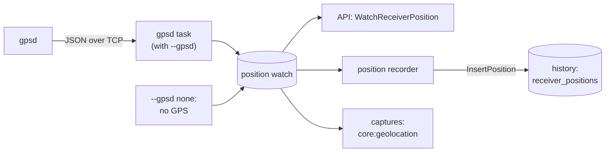

# GPS

Status: adsb has the clock warning and the receiver's position, as designed here. [Later](#later) is not
implemented.

A GPS can set the system clock, and can tell adsb where the receiver is, so the history and the captures record
where they were made. Setting the clock is the machine's setup, not adsb's. The receiver's position is a small
`gpsd` client in adsb, so it works with any GPS that `gpsd` reads.

## The system clock

Every time adsb records comes from the system clock. A machine with no network time source and no battery behind
its RTC boots with a wrong clock, and the wrong date reaches the history database. GPS fixes that:

- **chrony** reads `gpsd`'s time as a reference clock and steps the system clock to it. It can also serve NTP to
  other machines on a link.
- **[`tools/gps_set_clock.py`](../../tools/gps_set_clock.py)** sets the clock once from `gpsd`, where chrony
  isn't installed. It refuses without a 3D fix, and `--dry-run` prints the correction without setting anything.

NMEA time alone is good to about 10–100 ms, which is plenty for the history.

## adsb

### A clock warning

At startup, adsb warns when the system clock isn't synchronized, as `adjtimex()` reports it. A wrong date then
shows in the log, not in the database days later. This stands on its own, without a GPS.

### The receiver's position

With `--gpsd`, adsb reads the receiver's position from `gpsd` and publishes it, with the GPS's state, on a
watch. Without one, it publishes the state "no GPS" on the same watch, so the rest of adsb treats every run the
same way. The history records the watch in a table of position against time, joined to the
aircraft updates by time. The UI shows the GPS state in the top bar and the receiver on the map, live and in
history.



#### The state

Each value on the watch is a `ReceiverPosition`:

```proto
enum GpsState {
  GPS_STATE_UNSPECIFIED = 0;
  NO_GPS = 1;            // no gpsd to read: --gpsd none, or no --gpsd for a source without a default
  GPSD_UNREACHABLE = 2;  // gpsd isn't answering at --gpsd
  NO_FIX = 3;            // gpsd answers, but has no fix, or no GPS device; summary says which
  FIX_2D = 4;
  FIX_3D = 5;
}

message ReceiverPosition {
  double t = 1;                         // Unix s, system clock, when this state was reached or reported
  GpsState state = 2;
  optional double lat = 3;              // with a fix
  optional double lon = 4;
  optional double alt_m = 5;            // with a 3D fix
  optional double error_m = 6;          // gpsd's horizontal error estimate (eph)
  optional uint32 satellites_used = 7;  // when gpsd reports its sky
  optional uint32 satellites_seen = 8;
  string summary = 9;                   // one line for the log and the UI's tooltip
}
```

"No GPS" and "no fix" are different answers: the first means the receiver can't know where it is, the second
that it could but doesn't right now.

#### The gpsd task

A free coroutine in `src/input/gpsd.{h,cpp}`. It connects with a coro `TcpStream`, sends
`?WATCH={"enable":true,"json":true}`, parses the reports with nlohmann_json, and sets the watch from each `TPV`
and `SKY`.

- **The option:** `--gpsd host:port`, a global option, since where the position comes from has nothing to do
  with where the samples do: `adsb vita49` beside a radio reads the same `gpsd` as a source reading the radio
  directly. Its default is `none`, for the state "no GPS", except with `sidekiq`, whose default is the X40's own
  `gpsd`. The log says which it is and where it came from.
- **gpsd going away** doesn't stop adsb: the task retries every few seconds, and the state is
  `GPSD_UNREACHABLE` meanwhile.
- **Logging:**
    - INFO for the GPS in use at startup, connecting, the first fix, a fix lost or regained, and a move of more
      than 50 m;
    - a WARNING when there's no fix two minutes after starting, or after losing one, saying what's missing:
      `gpsd` unreachable, no GPS device, or how many satellites are seen and used;
    - a WARNING when the system clock is more than a second off GPS time, as each fix carries it: the history's
      times are wrong, and `tools/gps_set_clock.py` sets the clock.
- **Times are the system clock's,** even with a fix: the aircraft updates are stamped by it, and the join needs
  one clock on both sides.

#### The history

A table written by the history actor, through a new `InsertPosition` request:

```sql
CREATE TABLE receiver_positions (
  t REAL NOT NULL PRIMARY KEY,  -- system clock, as aircraft_updates.t
  state INTEGER NOT NULL,       -- GpsState
  lat REAL, lon REAL, alt_m REAL, error_m REAL,
  satellites_used INTEGER, satellites_seen INTEGER
);
```

- **A position recorder task** reads the watch and appends a row on a change of state, on a move of more than
  25 m, and otherwise once a minute. A fixed site's GPS wanders a few metres, so it writes about 1,440 rows a
  day; an input with no GPS writes the same, all `NO_GPS`.
- **The position at a time** is the latest row at or before it, if that row is less than 90 s old. The
  minute's row tells the three answers apart: a fix, the state the GPS was in (no GPS, unreachable, no fix), or
  "unknown", where nothing was recording.
- **The schema version goes from 2 to 3,** and a version 2 file is upgraded in place: the table is new and
  nothing else changes, so the existing files gain it and keep working. A file of any other version is still
  refused.

#### The API

- **`Receiver.WatchReceiverPosition`:** the current `ReceiverPosition` at once, then each change. A separate
  watch from `WatchInputStatus`: the input's `ok` means it keeps up, and a lost fix shouldn't read as dropped
  samples.
- **`Snapshot.receiver`:** the position at the snapshot's `t`, unset where it's unknown.
- **`History.GetReceiverPositions(from, to)`:** the rows in a range, for the state over time and for the
  receiver's track, should it ever move.

#### Captures

A capture's SigMF metadata gets `core:geolocation`, a GeoJSON point, from the watch when it starts, if there's a
fix.

#### The UI

- **A chip in the top bar,** beside the input status and in its style:
    - green, "GPS 3D · 9 sats";
    - amber, "GPS 2D", or a 3D fix with a large error;
    - red, "GPS: no fix" or "GPS: gpsd unreachable";
    - grey, "no GPS".

    Its tooltip has the position, altitude, error, the age of the fix and the summary.
- **The map** shows the receiver as a marker of its own: live from the watch, and in history from
  `Snapshot.receiver`, with "receiver position unknown" or "no GPS" where there's none. The map starts centred
  on the receiver when it's known.
- **Per aircraft, the range and bearing from the receiver,** in the detail panel and as a column the table can
  show, computed in the UI from the two positions. The position itself is per time, not per frame: at a fixed
  site a column of it would repeat one value on every row.

The position helps beyond the record, later:

- **CPR local decoding:** an aircraft is placed from one position message, rather than waiting for an even and
  odd pair.
- **Range statistics** and a heatmap relative to the receiver.

### Later

- **GPSDO status** in the input status, for a radio with one: enabled, locked, and its accuracy in ppm.
- **A fixed position,** given by option, for a receiver without a GPS, should one ever need it.
- **1PPS timing:** resetting the radio's sample counter on a GPS second makes each sample's time GPS-accurate,
  rather than the system clock at the start plus a count. The history doesn't need
  it; multilateration, locating aircraft from arrival times at several receivers, would.

## Order

1. Setting the clock.
2. The clock warning in adsb.
3. The position watch with the `gpsd` task, the positions table, the API, the UI, and the SigMF geolocation.
4. Optionally, the GPSDO status, then the 1PPS timing.

## Decisions

1. **Per change, not per frame:** a positions table, appended to on a change and once a minute, and joined by
   time.
2. **A watch of its own,** not `ReceiverInfo`, which is fixed for the run, and not part of `InputStatus`, whose
   `ok` is about the input keeping up.
3. **GPS is a global option, not a source's.** A run without one reports and records "no GPS", a state of its
   own, not "no fix".
4. **Version 2 history files are upgraded in place** to version 3.
5. **Range and bearing per aircraft,** and the receiver's position per time, not a column per frame.
