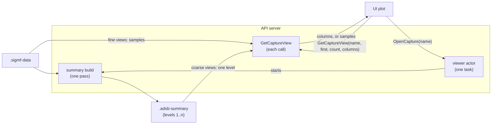

# IQ recording viewer

Status: being built; the server's side and the UI are written, untested. This is also the working document while it's
built: [Progress](#progress) goes once it's done, leaving the design.

The UI plots a recording from the capture directory: its magnitude over time, from the whole recording down
to single samples. Zoomed out it shows where the energy is, so a burst that never triggered the preamble
detector stands out; zoomed in it shows the pulses themselves. Later the plot carries the frames detected in
the recording, so a missed frame can be found and looked at.

The server reduces the recording to what the plot can show, so a request costs about the same at any zoom: a
few thousand columns, whatever the span. A summary of per-bucket statistics at several resolutions, built once
per recording, keeps that cheap for long spans.

## The recordings

Any `.sigmf-data` that `ListCaptures` lists, whoever wrote it. `RecordCapture` writes two kinds:

- **`INPUT`:** complex IQ as the source delivered it, `cf32_le` or `ci16_be`, at the input rate.
- **`ENVELOPE`:** the demodulator's envelope magnitude, real `rf32_le`, at its output rate.

The viewer takes all three datatypes; for a real recording the magnitude is the sample itself. Anything else
is refused with the datatype named.

`RecordCapture` stops at 60 s (`CapturePoint::kMaxDurationS`), which at 2.4 MS/s in `cf32_le` is 144 M
samples and 1.15 GB. A file from elsewhere may be any length, so nothing here assumes one fits in memory: each
request reads only the part of a file it needs.

The plot shows the recording's rate and datatype beside it. An `ENVELOPE` recording is at the demodulator's
rate, not the input's, and a pulse's width in samples differs between the two.

## What the plot shows

The x axis is time from the recording's first sample, with the sample index under the pointer. How it's drawn
depends on the samples per pixel column:

- **Zoomed out, more than 4 samples per column:**
    - the maximum magnitude in each column, as a filled band, so every burst shows at any zoom;
    - the mean power in each column, as a line: the noise floor;
    - a strip along the axis marking columns with clipped samples, for complex recordings with a known full
      scale (see [The full scale](#the-full-scale)).
- **Zoomed in, 4 samples per column or fewer:** the magnitude of each sample as a line, with a dot per sample
  once they're far enough apart to tell. An I/Q toggle appears here only, and overlays I and Q.

Over either, the recording's annotations (see [The annotations](#the-annotations)): a faint band and a bar
along the foot for each, colored by whether the frame's CRC failed, labelled on a solid tab of the bar's color
where the label fits, so a trace of the same color doesn't hide it. Those closer than a pixel merge into one
bar, and the readout describes the one under the pointer. A toggle hides them.

The y axis is linear magnitude or dB, the user's choice. Linear is what the demodulator sees, for pulse
shapes; dB shows weak bursts beside strong ones, for finding the ones the detector missed.

Picking or resampling samples would lose the pulses: an ADS-B pulse is 0.5 µs, about 1.2 samples at 2.4 MS/s,
and at 100 k samples per column a pick lands on one only by chance, while a low-pass smears it into the noise.
Every column is a reduction of all the samples under it instead.

No zoomed-out view of I and Q: the two things it shows, clipping and a DC offset, are kept as statistics of
their own.

## The summary

Level 0 is the recording. Level 1 groups it into buckets of `B1` samples, and each level above groups the one
below by `F`, so a level-`k` bucket covers `B1·F^(k−1)` samples. Proposed: `B1 = 256`, `F = 16`, and levels
until one bucket covers the recording. A level's last bucket covers whatever is left, so may hold fewer.

Each bucket keeps statistics that combine exactly from the buckets below it, so a level is built from the one
under it, never from the samples again:

| Statistic | Type | Combines by | Shows |
| --- | --- | --- | --- |
| `max_power`, max of \|x\|² | f32 | max | the burst band |
| `mean_power`, mean of \|x\|² | f32 | mean, weighted by samples | the noise floor |
| `mean_i`, `mean_q` | f32 | mean, weighted by samples | a DC offset, later |
| `clipped`, samples with I or Q at full scale | u32 | sum, saturating | the clipping strip |

A mean, not a sum, because a float sum over a long bucket loses the precision a mean keeps. Power, not
magnitude, so the dB view and the mean are both exact; the UI takes the square root for the linear view. For a
real recording, |x|² is the sample squared, and `mean_q` and `clipped` are 0.

At `B1 = 256`, 20 bytes a bucket, level 1 is about 1/100 of a `cf32_le` recording's size (1/50 of a
`ci16_be` one), 11 MB for the 60 s case, and all the levels above add about 1/15 of that.

### The summary file

Beside the recording, as `<name>.adsb-summary`, since the `.sigmf-` names belong to SigMF. It's a cache: it
can always be rebuilt from the recording, so a missing, stale or bad one is never an error, only a rebuild,
which is logged.

All fields are little-endian. The header is 64 bytes, then the level table, then the levels:

| Offset | Type | Field | Meaning |
| --- | --- | --- | --- |
| 0 | u8[8] | `magic` | `"ADSBSUM\0"` |
| 8 | u32 | `version` | 1. Any other is rebuilt, not read. |
| 12 | u32 | `bucket_bytes` | 20, the size of one bucket below, checked on read |
| 16 | u64 | `data_bytes` | the `.sigmf-data`'s size when the summary was built |
| 24 | i64 | `data_mtime_ns` | its modification time then, ns since the Unix epoch |
| 32 | u64 | `samples` | the samples in the recording |
| 40 | u32 | `datatype` | 1 `cf32_le`, 2 `ci16_be`, 3 `rf32_le` |
| 44 | u32 | `bucket1` | `B1`, samples in a level-1 bucket |
| 48 | u32 | `factor` | `F`, buckets of one level in a bucket of the next |
| 52 | u32 | `levels` | the number of levels, `n` |
| 56 | f32 | `full_scale` | the I or Q value counted as clipped; 0 when unknown, and `clipped` is then 0 |
| 60 | u32 | reserved | 0 |
| 64 | {u64, u64}[n] | level table | each level's byte offset in the file and its bucket count, level 1 first |

Each level is an array of buckets, each its five statistics side by side, so any view reads one contiguous run
of the file:

| Offset in the bucket | Type | Field |
| --- | --- | --- |
| 0 | f32 | `max_power` |
| 4 | f32 | `mean_power` |
| 8 | f32 | `mean_i` |
| 12 | f32 | `mean_q` |
| 16 | u32 | `clipped` |

For `ci16_be`, `full_scale` is 32767 and a sample is clipped with I or Q at 32767 or −32768. For `cf32_le` it
comes from the recording's `.sigmf-meta`, below, and a sample is clipped with \|I\| or \|Q\| at or over it.

A reader checks, before using a summary, that `magic`, `version` and `bucket_bytes` are as above, the level
table lies inside the file, and `data_bytes` and `data_mtime_ns` match the `.sigmf-data` now. Anything else
means a rebuild.

### The full scale

A `ci16_be` recording's full scale is the integer range, but a `cf32_le` one's depends on how the source
converted its ADC's samples to floats, which the samples don't say. So `RecordCapture` writes it into an
`INPUT` recording's `.sigmf-meta`, as a field of our own in the `global` object:

- **`adsb:full_scale`:** the float the source's largest ADC value converts to.
- **`core:extensions`** declares the `adsb` namespace, `optional: true`, so other SigMF readers ignore the
  field.

A `cf32_le` recording without it, from elsewhere or from before, has `full_scale` 0 in its summary and no
clipping strip. An `ENVELOPE` recording is a magnitude, not the ADC's samples, and gets none either.

### The annotations

`RecordCapture` annotates each frame the pipeline decoded in a recording, CRC failures too, in the SigMF
`annotations` array, in sample order. It doesn't decode the samples again: the capture takes the sink's frames
from the `frames` broadcast that `WatchFrames` reads, a block or more after the samples, so once the samples are
written it waits for the frames to pass the recording's end. Each annotation has:

- **`core:sample_start` and `core:sample_count`:** the frame's preamble and bits, 8 µs plus 1 µs a bit, in the
  recording's samples. A frame's stream index maps into the file through the `core:global_index` of the
  capture segment it starts in; one in a gap isn't annotated. An `ENVELOPE` recording places a frame by its
  envelope index, which the demodulator reports with it: the envelope's own count of its outputs, which drifts
  from the input's index converted to its rate by up to an output a block.
- **`core:label`:** the DF and the frame's summary, or that its CRC failed.
- **`adsb:` fields:** `stream_index` (the input's), `df`, `crc_ok`, `crc_checked`, `confidence`, `payload` (hex),
  and where known `icao` (hex), `crc_fixed_bit` and `summary`. An `ENVELOPE` recording adds `envelope_index`.

Frame blocks a slow writer lags behind are lost from the recording, logged at WARNING, and counted in the
`global` object's `adsb:frame_blocks_lost`. `OpenCapture` returns every annotation, any tool's: an `adsb:` one
with its frame rebuilt, another with its `core:label`, or `core:comment` without one. One it can't read, or
past the recording's end, is skipped and logged at WARNING.

### Building it

One sequential pass over the data, the first time a recording is opened, limited by the disk rather than the
arithmetic: level 1 from the samples, split with `coro::parallel()` across chunks, and each level above from
the one before. The levels above level 1 are under a tenth of its size, so they're built in memory and written
after it.

It writes beside the recording, in the capture directory; where that isn't writable, `OpenCapture` fails
rather than putting the summary anywhere else. It writes to `<name>.adsb-summary.tmp`, created exclusively,
so a second build of the same recording fails to create it rather than writing over the first's. It renames
the file into place when done, so a crash leaves no half-file to be taken for a whole one. A `.tmp` left by
a crash is removed by the next build.

## The calls

On the `Receiver` service, beside `ListCaptures`. Neither leaves anything open on the server for the client:
each names its recording, and is answered from what's on disk then.

- **`OpenCapture(OpenCaptureRequest) returns (stream OpenCaptureProgress)`:** makes sure the named recording
  has a current summary, building it if it has none or a stale one. Streams the build's progress, then one
  last message with what the plot needs: the sample count, rate, datatype, whether it's complex, the full
  scale if known, and the annotations. It ends there. Two calls on the same recording share one build.
- **`GetCaptureView(GetCaptureViewRequest) returns (CaptureView)`:** a unary call for one view:
    - **request:** the recording's name, the first sample and the sample count, the number of columns, and
      whether I/Q is wanted;
    - **reply, zoomed out:** a column each of `max_power`, `mean_power` and `clipped`, packed, and the samples
      each column covers;
    - **reply, zoomed in:** the samples themselves, packed as f32 pairs or reals, with their first index, and
      I/Q only if asked for.

The server picks the coarsest level whose bucket is no larger than the samples per column, reads the run of it
under the view, and reduces it to exactly the columns asked for. Below level 1 it reduces the samples instead,
which for a zoomed-out request is at most `B1` × columns samples, about 4 MB at worst. Above 4 samples per
column it replies with columns; at or below, with samples, which at 4 per column and 2000 columns is 64 KB of
`cf32`.

The view is any span, not tiles at fixed positions: a reply is tens of kilobytes over a local WebSocket, so a
client cache of tiles would buy little for what it costs the UI. If panning a long recording ever feels slow,
tiles are the next step, and the summary serves them as it is.

### Without `OpenCapture`

`OpenCapture` is only what builds a summary; nothing in `GetCaptureView` depends on it having been called. A
client that calls `GetCaptureView` alone gets:

- **a fine view:** an answer, from the samples, which need no summary;
- **a coarse view of a recording with a current summary:** an answer, from the summary, which may be from an
  earlier run;
- **a coarse view without one:** `FAILED_PRECONDITION`, saying to open the recording first.

The same rules cover a recording changed or deleted between the calls: the next view fails, or asks for the
summary to be rebuilt.

### Limits and errors

A client is never trusted with a path or an unbounded amount of work:

- **A name, not a path.** Both calls take a recording's name, under the rules `RecordCapture` applies to one:
  no `/`, not starting with `.`. The server resolves it inside the capture directory and nowhere else.
- **At most 8192 columns** a view, so a reply is bounded at any zoom.
- **A recording still being written** by `RecordCapture` is refused by `OpenCapture`, rather than summarised
  half-done.

The errors, in wsrpc's codes:

- **`INVALID_ARGUMENT`:** a bad name, a span past the recording's end, no columns or too many.
- **`FAILED_PRECONDITION`:** no capture directory, no such recording, an unknown datatype, no current summary
  for a coarse view, the recording still being written, or a summary that can't be written beside it.
- **`INTERNAL`,** logged: a read that fails or comes up short.

Each error's message names the recording and what was wrong with it, for the UI to show.

## The server's side

A viewer actor, one task, owns the builds in progress, each a task of its own, so two `OpenCapture` calls on
one recording share a build. `OpenCapture` sends it requests over one channel, each with a oneshot sender for
a watch of the build's progress, as the repo's [pipeline rules](../../CLAUDE.md#pipelines) have it for a
shared resource. `GetCaptureView` needs no actor: it only reads, and a summary is only ever replaced whole, by
a rename, so each call reads the files itself.

No file stays open between requests. Each view opens the files it reads, checks the data file is the one the
summary was built from, reads at offsets and closes them. See [File I/O](#file-io) for why.

It logs at INFO a recording opened, a summary built, rebuilt as stale or found bad, and the build's time;
each view request at `VLOGF(1)`.

## File I/O

Files are read with `coro::File`: `File::open`, then `read_at_exact` at the offsets a view needs, each a
`pread` loop on the runtime's blocking pool, as `file_stream.cpp` and `capture.cpp` read and write theirs.

Not memory-mapped. A mapped file that's truncated, or rewritten in place, while it's mapped raises `SIGBUS`
when a lost page is touched, which kills the server; a read of a truncated file comes up short instead, and
is an error the view reports. Reading at offsets also needs no state kept between requests, and the reads are
small: a view is one run of one level, or at most `B1` × columns samples.

coro's `File` covers the reads and writes. What it doesn't cover, and what the viewer does instead:

- **The size and modification time of the file just opened,** to check the summary against the same file the
  view then reads, not whatever the path names a moment later. coro has no metadata call. Added this round:
  `File::metadata()`, an `fstat` of the open file.
- **Creating the build's `.tmp` only if it doesn't exist.** coro has no exclusive create. Added this round:
  `FileMode::CreateNew`, `O_EXCL`.
- **Renaming the `.tmp` into place, and removing a stale one.** Out of coro's scope for now. The viewer uses
  `std::filesystem` in `coro::spawn_blocking`, as coro's doc says to. To be designed in coro: path
  operations, and an atomic replace on top of them.
- **Reading several runs of a file in one job.** coro makes each read one hop to the blocking pool. The viewer
  stores a bucket's statistics side by side, so a view is one read. To be designed in coro: several
  positional reads in one job.
- **Telling the kernel the build reads sequentially.** coro has no access hints. The viewer does without: the
  default read-ahead copes. To be designed in coro: hint flags at open.

The coro sections to be designed are described in coro's `doc/design/file_io.md`, under "Not yet: designs
to come".

## The UI

A View action on each recording in the capture list opens it in a viewer pane. The plot takes the mouse as the
spectrum's do, and as most plotting tools do. The wheel zooms about the pointer. A drag does what the mode bar
in the plot's corner says:

- **Zoom**, the default: the span dragged across is zoomed to when the button comes up.
- **Pan:** the view moves with the pointer.
- **Measure:** the span dragged across stays marked, and the readout gives its length and levels.

A right-drag does the other of zoom and pan, and pans in Measure; so does a shift-drag, for a trackpad. A
middle-button drag always pans. A web build turns the browser's context menu off so the right button is the
app's, as it is in a desktop build. A click places a marker, a right-click does nothing, and a double-click
shows the whole recording. Zoom out widens the view twice over about its centre: it has no history to keep
track of. Over the plot, Z, P and M pick the mode, minus or Backspace zooms out, Home shows it all, Escape
abandons a drag and ? lists all of this, as the mode bar's help button does. Zooms are of time only: the level
axis is fitted to the whole recording once, so a zoom doesn't rescale it. A readout gives the time and sample
index under the pointer, and the level there.

It keeps one request in flight. Views asked for while one is out replace each other, and only the latest is
sent when it returns, so a fast zoom never queues a backlog.

## Later

In the order they'd be built:

1. **More of the annotations.** Zoomed out, a count per column as a density strip. Clicking a frame in the
   frame list jumps to it in a recording.
2. **Phase and instantaneous frequency,** zoomed in, behind the I/Q toggle.
3. **A spectrogram** over the same time axis: FFT rows at a fixed hop, built once, with the levels above taking
   the max over neighbouring rows, as the magnitude levels do.
4. **Live frames.** A ring of the last few hundred detected frames' samples, a few hundred kilobytes, shown in
   the same plot from the frame list.

## Progress

- [x] This document drafted.
- [ ] This document reviewed.
- [ ] coro: `File::metadata()`, with its tests and `file_io.md`.
- [ ] coro: `FileMode::CreateNew`, with its tests and `file_io.md`. `capture.cpp`'s check-then-create of a
  capture's files can use it too.
- [ ] `RecordCapture`: `adsb:full_scale` and the `adsb` extension in an `INPUT` recording's `.sigmf-meta`, with
  each source's full scale.
- [ ] `api.proto`: `OpenCapture`, `GetCaptureView` and their messages.
- [ ] The summary: its file format, build and staleness check, with tests against a brute-force reduction of
  the same samples.
- [ ] The view reduction: level choice and reduction to columns, with tests at the level boundaries and the
  recording's ends.
- [ ] The viewer actor and the two handlers, with tests of the limits and errors.
- [ ] The UI: the View action, the pane, the plot and its mouse handling, the request coalescing.
- [ ] `B1` and `F` checked against a long recording, once it all works: a smaller `B1` serves medium zooms
  from the summary rather than the samples, at more disk.
- [ ] Annotations: `RecordCapture` writing the frames from the `frames` broadcast, `OpenCapture` returning
  them, and the plot's bars and readout.
- [ ] The rest of [Later](#later).
