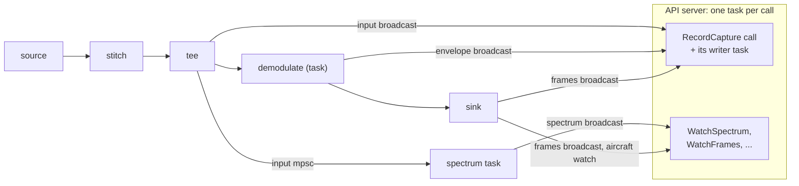

# Pipeline outputs: the pipeline owns its channels

Status: implemented.

The pipeline creates the channels it publishes on, and hands the API server a struct of handles to them,
`PipelineOutputs`. The server knows which point in the pipeline each handle reads, but not how or when the data
is made. A call that wants a point's data activates that point's handle, and gets a receiver of its own.

A stage does the work behind an output only while that output has active receivers, which the stage sees from
its own sender. No channel runs from the server back into the pipeline: demand is the receivers themselves.



Every arrow runs downstream. The server reads each broadcast through a receiver it activates for a call, and
drops when the call ends.

## The coro features it uses

Endpoints that hold a channel without keeping it open or counting as a reader, for the broadcast and the mpsc
(coro's `doc/design/channels.md`, "Inactive receivers and weak senders"). None of them waits, so a send stays
non-blocking.

- **An inactive broadcast receiver,** `coro::InactiveBroadcastReceiver<T>`. It receives nothing and doesn't
  count as a receiver:
    - `BroadcastSender::inactive()`, or `BroadcastReceiver::deactivate()`, makes one;
    - `activate() const` returns a new active `BroadcastReceiver` that reads from the next value sent, with no
      replay;
    - it's copyable, so the server keeps one and activates it once per call;
    - `all_receivers_dropped()` counts the active receivers only, so a sender sees when nobody reads, and a
      `send()` with none fails and stores nothing;
    - the channel still closes when its last sender drops, so activating a closed channel gives a receiver
      whose first `recv()` is `Closed`.
- **An inactive mpsc receiver,** `coro::InactiveMpscReceiver<T>`, for an output with one reader that reads
  only some of the time:
    - `MpscReceiver::deactivate()` makes one, and drops whatever is queued, so pooled buffers go back at once;
    - while it's inactive, `try_send()` fails as inactive and queues nothing, which a sender that drops when
      full already handles;
    - `activate()` consumes it and returns the receiver, which reads from the next value sent.
- **`co_await sender.receivers_active()`** on a broadcast, which waits until it has an active receiver, so a
  task that reads an output only to feed another can wait for its own readers rather than poll.
- **A broadcast value is dropped once every receiver has read it,** rather than when a later send overwrites
  it. A ring of `IqBlock`s then holds a block's buffer only until the slowest capture has written it, and
  nothing while no receiver is active.

## The outputs

`PipelineOutputs` is in `output/api_server.h`, beside `LiveFrames` and the other types it carries, as what the
server reads; the app fills it.

```cpp
struct PipelineOutputs {
    coro::InactiveBroadcastReceiver<LiveFrames> frames;         // the sink: every block's frames
    coro::WatchReceiver<LiveAircraft> aircraft;                 // the sink: the aircraft heard in 10 minutes
    coro::InactiveBroadcastReceiver<LiveSpectrumRow> spectrum;  // the spectrum task: peak-held rows
    coro::InactiveBroadcastReceiver<IqBlock> input;             // the tee: every block, in the source's format
    coro::InactiveBroadcastReceiver<EnvelopeShare> envelope;    // demodulate(): the resampled envelope
    CapturePoint input_point;     // how a capture of `input` is labelled
    CapturePoint envelope_point;  // how a capture of `envelope` is labelled

    PipelineOutputs clone() const;
};
```

| Point | Holds the sender | Does the work only while read |
|---|---|---|
| `frames` | the sink | yes: it builds a block's frames only while a call watches them or a capture annotates |
| `aircraft` | the sink | no: the tracker needs them anyway, and every UI reads them |
| `spectrum` | the spectrum task | yes: it reads the tee's mpsc only while its rows have readers |
| `input` | the tee | yes, at no cost: a send with no receivers stores nothing |
| `envelope` | `demodulate()` | yes: it copies a block's envelope only while it has readers |

- **`EnvelopeShare`** is `shared_ptr<const EnvelopeRun>`, as `LiveFrames` is for the frames, so every reader
  shares one copy rather than copying a vector out of the ring.
- **`IqBlock`** goes on the broadcast as it is: a copy is another reference to the same read-only samples, and
  the pooled buffer goes back when the last reader drops its copy.
- **A `CapturePoint`** is what a capture labels its recording with: the point's name, its rate, its center
  frequency if it has one, and the name of its gap plot. The pipeline fills both, since only it knows the
  rates.
- **The input status** is a watch that `main.cpp` makes beside the source, since the source isn't part of the
  pipeline. `api_server_spawn()` takes its receiver alongside the outputs, in `ReceiverFeeds`.
- **The settings are the server's alone,** made by `api_server_spawn()` from `ReceiverFeeds.settings`.
- **The debug recorder and the history** stay inside the pipeline. They aren't outputs the server reads.

## Building the pipeline

A coroutine can't hand back handles before it runs, so a plain function creates the stages' channels and
returns their handles with the coroutine, not yet started, as `mpsc_channel()` returns its two ends:

```cpp
struct DemodPipeline {
    PipelineOutputs outputs;   // for the server; they close when `run` ends
    coro::Coro<uint64_t> run;  // not yet started; the frames decoded
};

[[nodiscard]] DemodPipeline demod_pipeline(FilterBank filter, double rate_hz, double freq_hz,
                                           coro::CoroStream<IqBuffer> stream, DemodLoopParams params,
                                           std::optional<AircraftHistory> history);
```

- **The pipeline stays one coroutine in the header,** as every stage is. A `Coro` starts suspended, so `run`
  does nothing until it's spawned, and the server can activate a handle before or after.
- **`run` owns everything it uses:** the stages' senders, the filter, the rates and the params are its
  arguments, gathered in a struct private to `pipeline.cpp`.
- **Each channel's own receiver is dropped** as `demod_pipeline()` makes it. The outputs hold inactive ones,
  which don't count, so every stage starts with no readers.

`main.cpp` builds the source, builds the pipeline, spawns the server with `pipeline.outputs` when `--ws-port`
is given, and spawns `pipeline.run`. The server's spawn comes after the source's options are read, since the
pipeline needs the source's rate. Without `--ws-port` nothing activates a handle, so the spectrum task never
computes, the tee never stores a block, `demodulate()` never copies an envelope, and the sink builds no frames.

## Each output's stage

- **The tee** passes each block on to `demodulate()`, and `try_send()`s a copy of it to the spectrum task and
  sends one on the `input` broadcast. Neither send waits, so a slow reader can't slow the pipeline: the spectrum
  task misses blocks while its queue of 2 is full, and a capture gets `Lagged`, with how many blocks it missed.
  The broadcast's ring holds 8 blocks: at 128 Ki samples a block, a capture that falls 8 behind holds 8 MiB of
  cf32.
- **The spectrum task** is a permanent task, an actor that computes once for every viewer. Its input is an
  mpsc from the tee, not the `input` broadcast, since it's the one reader:
    1. it waits on `rows.receivers_active()`;
    2. it activates its mpsc receiver, and runs `spectrum_rows()` over it, sending each row on `rows`;
    3. when a row's send fails, as it does once the last viewer has gone, it deactivates the receiver, which
       drops the blocks queued, and goes back to 1.

    It logs starting and stopping at INFO. A viewer gets rows from the next one on, so the first waits up to one
    interval while the peak-hold fills. A viewer arriving just as the last one left waits one interval longer:
    `receivers_active()` resolves at once, and the task starts again.

- **`demodulate()`** sends each block's envelope on `envelope` while `!envelope.all_receivers_dropped()`,
  checked once a block, through a ring of 8.
- **The sink** builds each block's frames while `!frames.all_receivers_dropped()`, checked once a block, and
  publishes them, none too, with the stream indices the block ends at in the input and the envelope, and each
  frame's envelope index, so a capture of either knows how far the decoding has reached and where each frame
  is. It updates the aircraft watch for every block.

The pattern for a new output follows: the stage that has the data creates the broadcast, does the work only
while it has readers, and adds a handle to `PipelineOutputs`. A derived output, such as the spectrum, is a task
that reads an upstream output only while its own has readers, so demand passes upstream with no channel for it.

## RecordCapture: the call is the capture

- **The handler** checks the request, activates `input` or `envelope`, and `frames` with it, and hands the
  receivers and the point's `CapturePoint` to `run_capture()` (`output/capture.h`), which opens the files. A
  name that exists is `INVALID_ARGUMENT`, and files that can't be created are `INTERNAL`.
- **The writer** is a child task held in the capture's stream, so the call's cancel cancels it. It writes the
  items from its receiver and returns the result. A `Lagged` is a gap, which the next item's index shows; it
  starts a new SigMF capture segment, and is logged with its size and plotted. After each item it takes the
  frames buffered so far, without waiting; once its samples are written it drops the point's receiver and
  waits for the frames to pass its end, then writes them as the metadata's annotations
  ([iq_viewer.md](iq_viewer.md#the-annotations)). Frames it lags behind are lost, logged and plotted.
- **Progress is a watch,** `watch<RecordCaptureProgress>`, which the writer updates after each item and the
  handler yields from every `kReportInterval` (500 ms). Progress is latest-value state, so a dropped report is
  no special case. The handler's last reply is the writer's result.
- **A slow client can't hold the writer back.** The handler waits at its `co_yield`, but the writer never
  waits on the handler.
- **The input ending** closes the broadcast, so the writer finishes the capture with what it has.
- **There's no limit on captures,** of either point: two captures of one point are two receivers. A capture
  that falls behind, as several at a high rate may on a slow disk, loses samples rather than slowing the
  pipeline, and logs each gap. `CapturePoint::kMaxDurationS`, 60 s, limits each one's length.

## Testing (yours to run)

- **The server,** in `api_server_test`, which makes the outputs' channels as the pipeline does, and sends on
  them:
    - a spectrum call gets every row sent while it's in progress, and the rows have no readers before the first
      call or after the last ends, by a cancel or by its connection closing;
    - a capture of each point writes the samples sent after it starts, with its metadata, and its last report
      describes the recording;
    - a name that exists is refused;
    - samples that don't arrive are missing;
    - two captures of one point at once;
    - a capture whose writer lags covers its duration in samples and missing;
    - a cancel mid-capture, keeping what's written;
    - a capture running when the input ends.
- **End to end:** with the UI, a capture of each point replayed with `adsb file`, and the waterfall filling only
  while its pane is shown, in one UI or two. Tracy shows no spectrum work while no pane shows it, and no capture
  work while nothing is captured.
