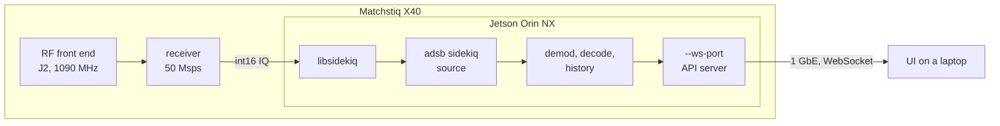
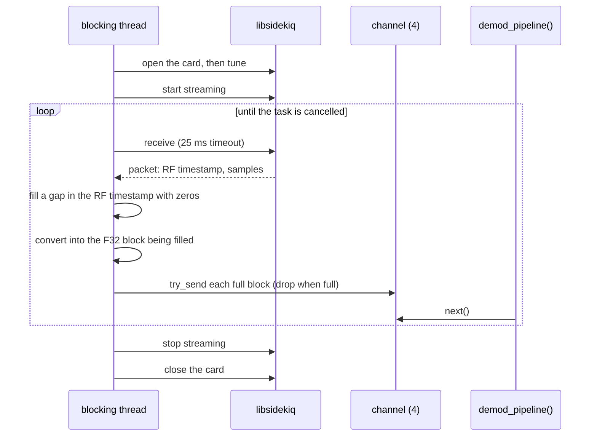

# Matchstiq X40 source (`adsb sidekiq`)

## Summary

`adsb sidekiq` reads IQ straight from an Epiq Matchstiq X40 through Epiq's libsidekiq. It runs on the X40's own
Jetson Orin NX, so the whole backend runs on the radio: the demodulator, the decoder, the history and the
`--ws-port` UI server. The UI connects to the X40 over its 1 GbE port, as it would to `adsb` on any other machine.

The source copies `adsb rtlsdr`:

- an RAII device class opens, tunes and closes the radio;
- a blocking read loop on a `spawn_blocking` thread gathers the packets into blocks;
- a small channel carries the blocks to the demodulator, and a block is dropped when the channel is full.

Nothing downstream changes. A build without the Sidekiq SDK's headers, CI's included, leaves the subcommand out.

A later step adds a `sidekiq` source to `vita49_send`. The X40 then streams VITA-49 to `adsb vita49` running on
another machine, which suits a radio mounted away from the computer that decodes.

## Where it runs



## Getting libsidekiq

libsidekiq is proprietary. Its SDK comes from Epiq with the radio. It can't be fetched by Conan or in CI, and the
repo never holds a copy of it. The build needs only the SDK's headers; the library itself is already on the X40,
beside the shared libraries it depends on.

### Loading it at run time

adsb loads libsidekiq with `dlopen()` instead of linking it. libsidekiq has shared-library dependencies of its own,
and some of the symbols they define are also defined by libraries adsb links statically. Linked together, one copy
of each would win, and libsidekiq would run on adsb's copy rather than its own.

Loaded with `RTLD_LOCAL`, libsidekiq resolves those symbols from the libraries beside it, and adsb, which exports
none of them, sees only the C functions it looks up with `dlsym()`. The lookup checks each function's type against
the SDK's header, so a header and library from different SDK versions fail to load, not misbehave.

`--lib` defaults to `libsidekiq.so`, a file name with no directory, so `dlopen()` searches `LD_LIBRARY_PATH` and
then the system's library paths for it. That is where libsidekiq's own dependencies are found, so the library and
its dependencies come from the same place. Pointing `LD_LIBRARY_PATH` at another SDK's libraries switches all of
them. The startup log and `adsb --version` name the file that was loaded.

The library is never closed: it keeps threads running inside it until the process exits.

## Building for the Jetson

### The CMake option

```cmake
option(ADSB_WITH_SIDEKIQ "Build adsb sidekiq (needs the Sidekiq SDK's headers)" OFF)
if(NOT DEFINED SIDEKIQ_SDK_DIR)
    set(SIDEKIQ_SDK_DIR "" CACHE PATH "Sidekiq SDK root, the directory holding sidekiq_core/inc")
endif()
```

The guard matters: under CMake 3.20's policies, `set(CACHE)` would erase the plain variable a Conan toolchain sets.

With `ADSB_WITH_SIDEKIQ` on, `adsb_input` builds `sidekiq_stream.cpp` against the SDK's
headers and links `libdl`. `main.cpp` adds the subcommand under `#ifdef ADSB_WITH_SIDEKIQ`. With the option off,
nothing refers to the SDK, so CI is unchanged.

Since nothing from the SDK is linked, the cross build ([jetson_toolchain.md](../jetson_toolchain.md)) builds the
source like any other. Its Conan profile sets both variables in `&:tools.cmake.cmaketoolchain:extra_variables`:

```text
"ADSB_WITH_SIDEKIQ": "ON", "SIDEKIQ_SDK_DIR": "/path/to/sidekiq_sdk"
```

### aarch64

The X40's Jetson is aarch64. The code has no x86 intrinsics, and the ispc kernels size their batches with
`programCount` rather than a fixed gang width, so they need only a target:

- **ispc:** `-DADSB_ISPC_TARGET=neon-i32x4`. ispc publishes Linux aarch64 releases, and `ISPC_ROOT` can point at
  one.
- **Conan:** the cross toolchain's `armv8` host profile. Some dependencies, such as protobuf, HDF5 and FFTW, have
  no prebuilt aarch64 package and build from source with `--build=missing`.

## The source

### Options

| Option | Default | Meaning |
|---|---|---|
| `--lib` | `libsidekiq.so` | libsidekiq to load: a path, or a file name to search `LD_LIBRARY_PATH` for |
| `--card` | 0 | libsidekiq card number |
| `--handle` | `A1` | receive handle: `A1` or `A2` |
| `--port` | libsidekiq's choice | RF port for the handle, such as `J2` |
| `--freq` | 1090e6 | centre frequency in Hz |
| `--rate` | 50e6 | sample rate in Hz; the card must run within 100 ppm of it |
| `--bandwidth` | 20e6 | RF bandwidth in Hz |
| `--gain` | auto | gain index, or `auto` for the radio's AGC |
| `--preselect-filter` | libsidekiq's choice | RF preselect filter, by its passband in MHz, such as `810-1170` |

`SidekiqStreamParams` holds them, with `add_options` and `from_options`, as `RtlSdrStreamParams` does.

### The rate

The demodulator resamples whatever arrives to 12 Msps, 12 samples per Mode S symbol. The X40 runs only at a set of
rates, and the defaults, 50 Msps with 20 MHz of bandwidth, are one of them. The startup INFO line gives the
handle's range of rates.

The rate read back must be within 100 ppm of `--rate`; otherwise opening the card fails with an error that gives the
rate it runs at and the handle's range. Labelling the samples with `--rate` would mislabel every one of them, and
`main.cpp` designs the filter for `--rate` before the card is opened. Within 100 ppm, a WARNING gives the rate read
back, the samples are labelled with `--rate`, and the resampler takes them to 12 Msps as it does any other rate.

50 Msps of 16-bit IQ is 200 MB/s. The Orin NX keeps up with it: a run shows no overruns or dropped blocks.

### The device class

`Sidekiq` is an RAII class, as `RtlSdr` is (coro's guideline CA.1), private to `sidekiq_stream.cpp`. The stream's
blocking thread constructs it, as initializing the card blocks. Its constructor:

1. loads libsidekiq, and routes its log messages to adsb's log;
2. registers a critical-error callback, which logs the error before the program exits;
3. opens the card. If another process holds it, the error names that process;
4. sets the IQ order to I then Q;
5. with `--port`, selects the RF port, after checking that the handle has it. A port the handle doesn't have is
   fatal, and the error lists the ones it has. The port comes first, as the settings after it depend on it;
6. sets the rate and bandwidth, and tunes;
7. with `--preselect-filter`, selects the preselect filter, checked the same way. It comes after the frequency,
   since tuning chooses a filter of its own;
8. sets the gain mode, and a gain index if one was given, checked against the card's range;
9. sets a receive timeout of 25 ms;
10. reads back the port, rate, bandwidth, frequency and gain in effect, and logs them at INFO. Without `--port`, the
    line marks the port as libsidekiq's choice and lists the others. A rate more than 100 ppm from `--rate` is
    fatal (see [The rate](#the-rate));
11. logs the front end's state in a second INFO line: its filters, calibration and RF port configuration, each as
    the radio reports it;
12. checks that the handle sends I/Q samples, not a test pattern, which would be fatal.

A setting the card rejects is fatal, except the gain, whose rejection is a WARNING: a gain only makes the output
worse, not wrong. A rate within 100 ppm of `--rate`, but not equal to it, is a WARNING, as is a bandwidth or
preselect filter other than the one asked for.

`read()` starts streaming, receives until its task is cancelled, and stops streaming however it ends. The
destructor closes the card, so it is released on every exit path.

### The read loop



Each receive returns one packet: its samples and the RF timestamp of the first. The packet lies in a buffer the
radio soon reuses, so the loop converts it before it receives again.

The loop's details:

- **Blocks:** a packet is far too small for the demodulator's per-block cost, so packets are gathered into blocks
  of 128k samples, the size `adsb file` reads.
- **Conversion:** the X40's samples are 16-bit. Dividing by 32768 gives F32 in [-1, 1), the same scale as the other
  sources.
- **Lost samples:** the RF timestamp should advance by the same step for every sample. The step is learned from the
  first two packets rather than assumed. When the timestamp jumps, the radio overran and samples are lost; the loop
  fills them with zeros, so stream time keeps pace with the radio's. It logs a WARNING (rate-limited) and a
  `TRACE_PLOT` of the samples lost. A jump of more than 8 blocks is logged and not filled, so a timestamp that
  jumped can't flood the channel with zeros. If the step can't be learned, a WARNING says so and gaps aren't filled.
- **Overload:** a packet whose RF input overloaded logs a rate-limited WARNING suggesting a lower gain.
- **Drops:** when the channel is full, the block is dropped. That is logged and plotted the same way. The block's
  samples still count, so a drop is a gap and not a shift.
- **Timeout:** a receive that returns no packet within 25 ms isn't an error. The loop calls
  `coro::blocking_cancellation_point()`, and receives again if the task wasn't cancelled.
- **Stopping:** dropping the stream drops the `spawn_blocking` handle, which cancels the task. The loop sees it at
  its next check, at most 25 ms later, and stops streaming. The thread opens and owns the `Sidekiq`, so the card is
  released only once the read has ended, never under a read still running. The channel closes after that, and the
  stream ends. A receive error ends the read the same way, and the stream rethrows it after its last block.

!!! note "Input status"
    `adsb vita49` reports an `InputStatus` to the UI: how much of the signal arrived and was demodulated.
    The RF timestamp gives the same numbers, so `adsb sidekiq` can report it too. That can come after the first
    version, which reports nothing, as `adsb rtlsdr` does.

## Later: `vita49_send sidekiq`

With the X40 mounted away from the decoding machine, `vita49_send` runs on the Jetson instead of `adsb`. A
`sidekiq` source for `vita49_send` reuses the `Sidekiq` class in `sidekiq_stream.cpp`. It sends each packet's
samples as VRT data packets, with the timestamps taken from the RF timestamp, and the rate, frequency and gain in
its context packets.

At 50 Msps, 16-bit IQ is 200 MB/s, or 1.6 Gb/s, more than the X40's 1 GbE port carries. The source would have to
resample on the Jetson first: at 12 Msps it is about 400 Mb/s.

## Alternatives

- **SoapySDR with SoapySidekiq:** SoapySidekiq is Epiq's open-source (Apache-2.0) SoapySDR module. It still links
  libsidekiq, and needs the SDK to build, so it doesn't avoid the proprietary library. It adds SoapySDR as a
  dependency for one radio, when the source needs only a handful of libsidekiq calls.
- **`vita49_send sidekiq` first:** it would leave adsb itself on x86, but the radio would need a second machine to
  be useful. Running the backend on the Jetson makes the X40 a self-contained receiver.

## Testing

CI has no X40, so it doesn't build the source. Testing is manual, on the radio:

1. Cross-build with `ADSB_WITH_SIDEKIQ` on, and copy `adsb` to the X40.
2. With nothing else using the radio, run `./adsb --ws-port 8080 sidekiq`, with libsidekiq's directory on
   `LD_LIBRARY_PATH`, and check the startup log for the port, rate, frequency, gain and RF timestamp step in effect.
3. Check that aircraft are heard, and compare them with an RTL-SDR at the same site.
4. Load the Jetson, and check that overflows and drops are logged and the stream recovers.
5. Stop with Ctrl+C, and check that a second run can open the card, which shows the first released it.

## Open questions

- **Gain:** what the X40's gain indices are in dB, and whether its AGC is any good with ADS-B's short bursts.
  The other sources use a fixed gain. If the AGC isn't usable, `--gain` takes a value in dB and the source maps it
  to an index.
- **A 16-bit host-order format:** converting to F32 in the read loop is simplest. If it's too slow on the Jetson,
  a new `iq::I16` format would hand the samples on as they are, as `I16Be` does for VITA-49.
- **Front end:** whether 1090 MHz needs an external LNA or filter in front of the antenna port.
