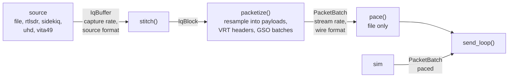

# Every source for vita49_send

`vita49_send` takes every source `adsb` has by reading the same `CoroStream<IqBuffer>` that `adsb` reads.
After `stitch()` comes one new stage, `packetize()`. It lays out VRT packets in GSO batches, and writes each
block's samples straight into their payloads, in the wire format chosen: `I16Be` or `F32Be`. On the way it
can resample them to any lower rate. A new I/Q resampling kernel does all of that in one pass: the filter,
the rate change and the format conversion. The batches go to the existing `send_loop()`, and the sources
don't change.

This is a working design, with every [decision](#decisions) it needs made. The receiver's handling of
`F32Be` is untested, and is revisited if it doesn't take it.

## Where things stand

Each app has its own sources, built around what it sends down its pipeline:

| Source | `adsb` | `vita49_send` |
|---|---|---|
| `file` | `file_iq_stream`: `cf32_le` as `F32`, `ci16_be` as `I16Be` | none |
| `rtlsdr` | `rtlsdr_iq_stream`: u8 to `F32` in the callback | `rtlsdr_packet_stream`: u8 to `I16Be` into each packet |
| `sidekiq` | `sidekiq_iq_stream`: int16 to `F32` through an `IqBlockChunker` | none |
| `uhd` | `uhd_iq_stream`: `fc32` through an `IqBlockChunker` | none |
| `vita49` | `vita49_iq_stream`: the VRT assembler drains `I16Be` into an `IqBlockChunker` | none |
| `sim` | only `adsb_sim_eval`'s `sim_blocks`, unpaced | `sim_packet_stream`: renders into GSO batches, paced |

`adsb`'s sources already live in `src/input/`, which both apps link. Each has its own
`add_options`/`from_options(program, cmd)` there, with its own `--rate` and `--freq`, and each yields padded
blocks of 128k samples.

## Requirements

- **Any source.** `vita49_send` gets `adsb`'s source subcommands, with the same options. It keeps `sim`.
- **A lower stream rate.** It can stream at any rate below the capture rate, low-pass filtered so that nothing
  aliases into the band it keeps.
- **A chosen wire format.** `I16Be` at least, for the third-party receiver, and `F32Be` as well. A context
  packet says which.
- **Unchanged receiver.** `adsb vita49` still receives an `I16Be` stream.
- **Statistics.** A run that falls behind keeps sending, and counts and logs what it dropped.

What fits on the wire, counting UDP, IP and Ethernet framing. Packets are 360 samples as `I16Be` and 180 as
`F32Be`, 1460 bytes of VRT either way:

| Stream rate | Format | Packets/s | On the wire | 1 GbE |
|---|---|---|---|---|
| 6 Msps | `I16Be` | 17k | 203 Mbit/s | fits |
| 6 Msps | `F32Be` | 33k | 407 Mbit/s | fits |
| 12.5 Msps | `I16Be` | 35k | 424 Mbit/s | fits |
| 25 Msps | `I16Be` | 69k | 848 Mbit/s | too close |
| 50 Msps | `I16Be` | 139k | 1.7 Gbit/s | no |

## Decisions

- **Any output rate.** `--stream-rate HZ` sets it, rather than an integer decimation factor. The resampler
  is a polyphase filter like `demodulate()`'s, with I/Q out.
- **Sources keep their formats.** Each source yields what it does today. Every conversion is inside the
  resampling kernel, as it writes each output.
- **Output formats.** `--stream-format ci16_be|cf32_be`, defaulting to `ci16_be`. Full scale maps to full scale: the
  kernel multiplies each output by `out::full_scale / in::full_scale`, so the filter applies no gain of its
  own.
    - The Sidekiq's `F32` is its int16 divided by 32768, so `I16Be` out is in the radio's own counts.
    - `F32Be` from `F32` is a factor of 1.
- **A kernel of its own.** The I/Q kernel shares the format helpers and fixed-point constants with
  `demodulate()`'s, but not its body.
- **No link checks.** `vita49_send` sends as fast as it is given samples. If it falls behind, the
  [statistics](#statistics) say so.
- **The resampler is a `src/dsp/` class.** It is a general DSP utility.
- **Today's stream stays available.** `--stream-format ci16_be` with the default packet size is today's data
  stream. The context adds the Data Payload Format field, and `--no-payload-format` leaves it out, so the
  context is today's too.
- **Filter options of its own.** `--stream-taps`, `--stream-phases`, `--stream-cutoff`, `--stream-window` and
  `--stream-kaiser-beta`, rather than `FilterOptions`, whose help text and defaults are for `adsb`'s resampler
  and whose `--filter-matched` means nothing here. The defaults come from the rate ratio: about
  20 × r_in / r_out taps, 64 phases, Kaiser, and a cutoff of 0.4 of the output rate.
    - They are top-level options, read into `StreamOptions` in `packetize.h` along with `--stream-format`,
      `--samples-per-packet` and `--no-payload-format`.
    - A filter option without `--stream-rate` is an error, since there is no filter for it to set. So is
      any resampling option with the `sim`, which renders `I16Be` at its own `--rate`.
- **Clipped samples are counted.** `I16Be` output saturates, which only a signal near full scale reaches. The
  kernel counts it, and `packetize()` logs it at WARNING with `LOGF_EVERY_N_SEC`.
- **The stages live in the app.** `packetize()` and `pace()` go in `src/apps/vita49_send/`, since
  `PacketBatch` and `PaceStats` belong to it.
- **Stages hide their details.** A stage's header declares a params struct and the stage's free coroutine.
  Its state and helpers are classes and functions in the `.cpp`'s anonymous namespace.

## The design



Each arrow is a bounded channel, and each stage is a task, as in `adsb`. `main.cpp` builds the chain for the
subcommand it was given, and `send_loop()`, which already takes any `CoroStream<PacketBatch>`, is unchanged.

Without `--stream-rate` the chain is the same:

- **The resampler** has one phase of one unit tap at a ratio of 1, so the kernel only converts the format.
  There is one path for every case, and the only conversion code is the kernel's.
- **The source's blocks** have a few samples of trailing padding, since the kernel reads its one tap as a
  16-lane batch. `stitch()` fills them from the next block, which delays each block by one: 2.6 ms at
  50 Msps.

### Sources

- **What doesn't change.** `main.cpp` adds each source's subcommand with that source's own `add_options`, and
  calls the source's stream function with the padding the resampler needs.
- **Context packets.** The rate and frequency for the IF Context packet come from the source's params.
  `vita49_send`'s top-level `--rate` and `--freq` move into the `sim` subcommand.
- **Drops.** A real-time source already drops, logs and plots when its channel is full, so back-pressure from
  any later stage ends at the source, as it does in `adsb`.
- **`rtlsdr`.** `vita49_send`'s `rtlsdr_source.*` is replaced by `adsb`'s `rtlsdr_iq_stream`, which has the
  same options. Its `F32` goes to `I16Be` in the kernel.
- **`sim`.** The sim keeps its own path. It renders straight into packets, is paced, and runs at up to
  200 Msps.

### packetize()

`packetize()` takes stitched blocks and sends full GSO batches of data packets. Its header declares only
`PacketizeParams` and the stage:

```cpp
coro::CoroStream<PacketBatch> packetize(coro::CoroStream<IqBlock> blocks, PacketizeParams params,
                                        IqResampler resampler, coro::WatchSender<PaceStats> pace_tx);
```

For each block it does what the sim's generator does for each render step. It lays out the packets first,
then fills their payloads, splitting that work across the workers:

1. **Lay out.** It asks the resampler which stream-rate samples the block produces, and lays out packets for
   them in the batches it holds. A packet that the last block ended partway through is finished first.
    - It takes each batch from a `net::BatchPool`, and lays it out as header, payload, header, payload.
    - It writes each header in place as it lays the packet out: stream id, the 4-bit counter, and the
      timestamp from its `vrt::PacketClock` at the stream rate. All three are known before any sample is.
    - The result is a list of payload spans, each tagged with the stream-rate sample it starts at.
2. **Fill.** It splits the spans into `coro::parallel()` parts. Each part runs the resampler over its spans,
   reading the block and writing the wire format straight into the payloads.
3. **Send.** It sends each batch that is now full down the channel, and keeps the one still filling.

Around those steps:

- **Context packets.** Its `vrt::ContextSender` sends one when it is due, as a batch of its own, between data
  batches.
    - The context carries the stream rate and the source's frequency.
    - Its bandwidth is twice the resampling filter's cutoff, or the rate without resampling.
    - It also carries the Data Payload Format field (CIF0 bit 15), which says what the payload holds:
      complex Cartesian, as 16-bit signed fixed point or 32-bit IEEE float. It is the last field, after the
      sample rate, since fields go in bit order.
    - With `--no-payload-format` it leaves that field out, and the context is today's: bandwidth, RF
      reference frequency and sample rate. A receiver then has to be told the format, which is only safe for
      `I16Be`, so that pairing with `cf32_be` is an error at startup.
- **Packet size.** `--samples-per-packet` defaults to what fits a 1500-byte MTU in the wire format: 360 for
  `I16Be`, 180 for `F32Be`.
- **Gaps.** When a block's `start` doesn't follow on from the last, it ends the part-filled packet as a short
  one. That packet goes at the end of its batch, since GSO allows only the last datagram to be short. It
  moves the clock and the counter on, so that a receiver sees the gap, and counts the lost samples on
  `PaceStats`.
- **The end.** When its stream ends it sends the part-filled packet and batch.
- **Back-pressure.** It awaits room in the channel, so a stalled sender holds it back, and that holds back
  the source, which drops and logs.

The batch layout state, the span list, and the fill parts are a class and functions in `packetize.cpp`'s
anonymous namespace.

### The resampler

`IqResampler` resamples a stream of blocks to any rate and format: a polyphase low-pass filter, evaluated
only at the output positions. It is a plain class in `src/dsp/`, so it can be tested without a pipeline.
`main.cpp` builds one at startup, and `packetize()` calls it once per span.

- **Filter.** `design_filter_bank()` for the input and output rates, as `adsb` designs its own. The bank's
  cutoff is clamped to the output Nyquist frequency, so it is the anti-alias filter.
    - Each phase is scaled to unity DC gain, so the filter keeps the input's amplitude.
    - Going from 50 Msps to 6 Msps with a cutoff of 2.4 MHz (0.4 of the output rate), the filter has 1.2 MHz
      to fall off before content would alias into the band it keeps. For about 60 dB there, a Kaiser window
      needs about 160 taps per phase.
- **Padding.** The filter reads half its taps either side of each output, and `stitch()` has filled the
  block's padding with its neighbours' samples. So an output near a block edge sees continuous signal.
  `IqResampler::padding()` gives the sizes the source must allocate, as `demod_padding()` does for `adsb`.
- **Schedule.** `demodulate()`'s schedule restarts at each block's own sample 0. The stream needs one that is
  continuous across blocks, since its outputs go out back to back.
    - Output k of the stream sits at input position k × r_in / r_out. Both rates are whole numbers of Hz,
      since `vrt::PacketClock` keeps its rate as an integer, so the host can compute that position exactly in
      integers, with a 128-bit product.
    - For each span it computes the exact position of the span's first output, relative to the block, and
      hands the kernel that as its fixed-point `offset`. The kernel steps from there in fixed point. Its
      rounding error then lasts one span, a few hundred outputs, and never accumulates.
    - Each output is put at the phase nearest its position, as `demodulate()` puts its own: the span's offset
      adds half a sample for an odd tap count, whose window is centred on its base sample, and nothing for an
      even one, centred half a sample later.
    - A block whose samples start at `start` produces the outputs whose positions fall in
      [start, start + n). A gap in the input is a gap in the output, scaled by the rate ratio.
- **Call.** `outputs(block)` gives the range of stream-rate samples a block produces.
  `run(block, first, out)` writes outputs `first` onward into `out`, in the output format, as many as fit.
  The input format comes from the block's `visit()`, and the output format from the one the resampler was
  built with.
- **Kernel.** `resample_iq_IN_OUT`, separate from `demodulate()`'s, with one export per pair of input and
  output formats.
    - It shares `load()` per input format with the envelope kernel, and adds a `store()` per output format:
        - `I16Be` rounds, saturates to the int16 range, and swaps the bytes.
        - `F32Be` swaps the bytes of the float.
    - It filters in single-precision float, as `demodulate()`'s does, and applies the format scale once per
      output.
    - It takes any output count. The last batch's stores are masked, since a payload span is not a whole
      number of 16-lane batches.
    - It counts the outputs that `store()` saturated, in either component, and returns the count. The host
      calls it once per span, with no task launch of its own, so `run()` returns each span's count and
      `packetize()` adds up its parts'.
- **Cost.** At 6 Msps out and 160 taps, that is about 4 GFLOP/s, a fraction of one core.
- **Startup.** `StreamOptions::make_resampler()` logs the input and output rates and formats, the taps, the
  phases, the window and the cutoff at INFO, marking those chosen from the rate ratio. The class itself
  doesn't log, since tests build many of them.

### Formats

`F32Be` is an output format only, for now: a tag in `iq_format.h` with its `Sample` and `full_scale`, not a
member of `iq::Formats`. Adding it to `iq::Formats` would make it a block format, which needs `demodulate()`
to have a kernel for it.

A new block format later takes:

- **Its trait.** A tag in `iq_format.h`, added to `iq::Formats`. `IqBlock`'s variant and every `visit()`
  follow from that list.
- **The kernels.** A `load()`, and a line per kernel macro. ispc has no templated exports, so each
  `resample_iq` pair is a line of its own, and its host-side specialization another. The pairs are a short
  table, written out.
- **The edges.** `demodulate()`'s kernel specialization, its SigMF name, and its VRT payload descriptor.

A packed format, such as 12-bit samples, doesn't fit a trait whose `Sample` is one stored component, and
would need more than a tag.

### Receiving

The assembler already knows the Data Payload Format field's size and skips it. It now reads it, and ends the
stream with an error for a format it doesn't take, rather than reading float samples as int16. For
`adsb vita49` that is `I16Be` only, so `adsb` can't yet receive `F32Be`. A context without the field is taken
as `I16Be`, so today's senders still work.

### Pacing

A file has no clock, so `vita49_send file` would send as fast as the socket takes it. `pace()` holds back each
`PacketBatch` until the wall clock reaches its last sample, and goes between `packetize()` and `send_loop()`.
It is the consumer half of `sim_packet_stream()` moved into a stream node of its own, and counts a late batch
on `PaceStats` as the sim does now. It is only for `file`. If it turns out to be more than a move, it can wait
for a later round.

### Statistics

Most of this is in place already:

- **`send_loop()`** publishes the samples sent and the time spent in socket sends on `PaceStats`. It logs the
  run's totals at the end, as a warning if anything was dropped.
- **`pace_monitor_loop()`** logs once a second while any of the overrun counts is rising.
- **Sources** log and plot their own drops, as they do in `adsb`.

What's new is two counts that `packetize()` adds to `PaceStats`:

- **Gaps.** The samples missing from the source's stream. The monitor's report and the end-of-run summary
  include it with the other overruns. That also counts samples lost before the source, such as the gaps a
  `vita49` source's assembler fills.
- **Clipped.** The `I16Be` outputs that saturated. `packetize()` logs it with `LOGF_EVERY_N_SEC` while it
  rises, and the end-of-run summary gives the total.

## Headers in the guard padding

To send the source's samples with no copy at all, a source could leave room for each packet's header in its
block, so that the block is sent as it is. The header is 20 bytes, exactly 5 `I16Be` samples, so a block with
a 5-sample lead, 360 samples and no trail has a data packet's exact layout.

Resampling rules this out. The padding has to hold the neighbours' samples, which `stitch()` puts there, and
a buffer can't hold both. The resampler's output is new samples in any case, and it is written where they
are sent from.

## Sources writing into sinks

The earlier version of this design shared the sources at a lower level. A source wrote samples into a sink.
`adsb`'s sink cut them into `IqBuffer`s; `vita49_send`'s cut them straight into packets, without a block in
between.

It is set aside for now, because the new requirement removes most of its gain:

- **Overlap.** The resampler needs padded, stitched blocks, which `vita49_send` gets for free by reading the
  blocks `adsb` already reads.
- **The saving.** The kernel writes every output once, straight into the packet, so the sink would save
  nothing.
- **The cost.** The sink would need a new interface in every source, with a decision on back-pressure, formats,
  pacing and drop accounting.

`packetize()`'s layout step is that sink's packet side, kept inside `vita49_send`. The sink design is still
the way to give `adsb` the paced `sim`, and to make the sim's packet path the same as every other source's.

## Not changing

- The sources, `IqBuffer`, `IqBlock` and `stitch()`.
- `demodulate()` and its kernel, apart from sharing `load()`, and everything else in `adsb` but the
  assembler's format check.
- `send_loop()`, GSO, and `vita49_send`'s sim.
- The device classes: `RtlSdr`, `Sidekiq`, and the VRT `Assembler`'s reassembly.
