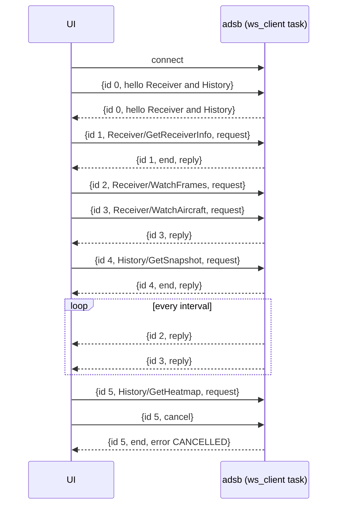
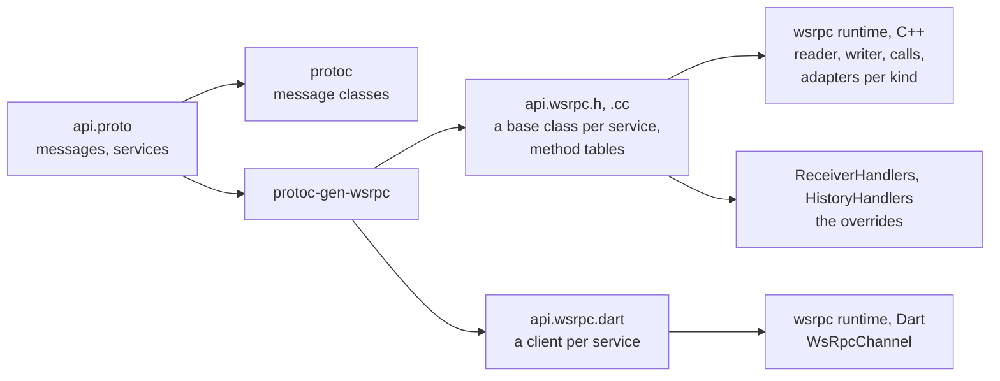

# UI API: protobuf calls over the WebSocket

Status: the target design. `proto/adsb/api/v1/api.proto` has its interface; the code is on its way there,
in the stages of [Order of work](#order-of-work).

Everything the UI and `adsb` say to each other is a call: a request answered by one reply or a stream of
them. The calls are defined once, as `service` blocks in `proto/adsb/api/v1/api.proto`, in gRPC's syntax.
A protoc plugin of our own, `protoc-gen-wsrpc`, reads them and generates both ends' protocol code: the
server's handler interfaces and dispatch in C++, and the UI's clients in Dart. Protobuf serializes the
requests and replies; everything else on the wire is a small framing message of our own, carried on coro's
WebSocket. Old formats aren't kept: the history database, the wire format and the UI change together.

What it buys:

1. **One definition of every call.** Each rpc's name, request, reply and streaming kinds are written once,
   in the `.proto`. Neither end keeps its own copy of which request pairs with which reply.
2. **Handlers checked against it at compile time.** Each service's generated C++ base class declares a pure
   virtual method per rpc. A handler with the wrong signature fails at its `override`, and a missing one
   leaves the class abstract.
3. **Handlers that know nothing about the transport.** A handler is a plain coroutine that takes its
   request message. A test calls it directly, with no socket.
4. **Features as services.** A server serves only the services it has, and says which on connect, so the
   UI shows what's there without a flag per feature.
5. **Room to grow.** A new call is an `rpc` line, its two messages and an override. The routing and the
   UI's method are generated.
6. **Room to change.** A UI and a server built a little apart still work together, as gRPC's do: protobuf
   reads a message with fields it doesn't know, and a call the server doesn't have yet is `UNIMPLEMENTED`.
7. **Smaller messages.** The spectrum's 1024 bins go out as packed floats, and frame payloads as bytes.

The server borrows its shape from coro's gRPC example (`examples/grpc/include/grpc_server.h`), with
the changes described in [What we take from coro's gRPC example](#what-we-take-from-coros-grpc-example).

## gRPC, or our own protocol

**Recommendation: gRPC's service definitions, our own protocol over coro's WebSocket.**

- **Real gRPC doesn't reach the browser.** The UI builds for web as well as Linux. Browsers can't speak
  gRPC's HTTP/2 framing, so a web build needs gRPC-Web and a proxy (Envoy or similar) in front of the
  server, or a server that speaks gRPC-Web itself.
- **The server side would be fine.** coro's `examples/grpc` (`GrpcServer` in `grpc_server.h`) already
  runs an async gRPC server on the runtime. The cost there is only the dependency: Conan's `grpc` brings
  c-ares, re2 and OpenSSL with it.
- **Connect,** gRPC's browser-friendly cousin, has a Dart client but no C++ server. We'd be writing one on
  top of an HTTP server that coro doesn't have.
- **gRPC's own generators don't fit.** They emit code for gRPC's transport. Dart's `protoc_plugin` can emit
  service stubs, but only unary ones over its `RpcClient`. Our plugin emits code for our transport, for
  every kind of call.

Since the `service` blocks are standard, a real gRPC endpoint for a non-browser client (Python tooling,
`grpcurl`) can sit beside the WebSocket later, built on coro's example, with the same messages and the same
handlers.

## The services

Two services, split by what the server has:

```proto
// The live pipeline. Served with a live input, not by `serve`.
service Receiver {
  rpc GetReceiverInfo(GetReceiverInfoRequest) returns (ReceiverInfo);

  rpc WatchFrames(WatchFramesRequest) returns (stream FrameBatch);
  rpc WatchAircraft(WatchAircraftRequest) returns (stream AircraftChanges);
  rpc WatchInputStatus(WatchInputStatusRequest) returns (stream InputStatus);
  rpc WatchReceiverPosition(WatchReceiverPositionRequest) returns (stream ReceiverPosition);
  rpc WatchSpectrum(WatchSpectrumRequest) returns (stream SpectrumRow);

  rpc WatchSettings(WatchSettingsRequest) returns (stream Settings);
  rpc UpdateSettings(UpdateSettingsRequest) returns (Settings);

  rpc RecordCapture(RecordCaptureRequest) returns (stream RecordCaptureProgress);
  rpc ListCaptures(ListCapturesRequest) returns (ListCapturesResponse);
}

// The history database. Served with --history-db.
service History {
  rpc GetSnapshot(GetSnapshotRequest) returns (Snapshot);
  rpc GetAircraftHistory(GetAircraftHistoryRequest) returns (AircraftHistory);
  rpc GetActivity(GetActivityRequest) returns (Activity);
  rpc GetHeatmap(GetHeatmapRequest) returns (Heatmap);
  rpc GetReceiverPositions(GetReceiverPositionsRequest) returns (ReceiverPositions);
}
```

`api.proto` has the messages, with what each field means.

- **A feature is a service.** `serve` doesn't serve `Receiver`, and a run without `--history-db` doesn't
  serve `History`. The hello's answer lists what's served, and a call to anything else is `UNIMPLEMENTED`.
  So no reply carries a flag saying what's answered, and no handler checks whether it can answer.
- **Four kinds of call,** each written in its `rpc` line:
    - **unary:** one request, one reply;
    - **server streaming,** `returns (stream ...)`: one request, then replies until the server ends the
      call or the client cancels it;
    - **client streaming,** `(stream ...)`: requests until the client ends its side, then one reply;
    - **bidirectional,** both: requests and replies, each side ending its own.

    The protocol, the runtime and the generator support all four, though no call streams from the client
    yet. The runtime's tests cover them with a test service.
- **Names follow Google's API conventions** ([AIP-131](https://google.aip.dev/131) and on): `Get` for a
  one-off read, `List` for a collection, `Update` for a change, and `Watch` for a stream whose first reply is
  the state now and whose next ones are its changes. Each rpc takes a request message of its own, even an
  empty one, so a field can be added later without changing the call. A later `DeleteCapture`, or a
  `ReadCapture` that streams a recording's bytes, fits the same pattern.
- **One stream per kind of live data.** Frames are a log of events, the aircraft are state sent as
  changes, and the input status is state sent whole. Each is a `Watch` of its own, so each handler is one
  simple loop and a page watches only what it shows.
- **What clients set is `Settings`.** The capture directory is its first field; the frequency and sample
  rate would join it ([Later: settings a client sets](#later-settings-a-client-sets)). `UpdateSettings`
  changes the fields its request sets, and every client hears the change through `WatchSettings`.
- **A recording is one message, `Capture`,** whether it's the one `RecordCapture` just wrote or one of those
  `ListCaptures` found.
- **The message choices:**
    - **ICAO addresses are `uint32`,** not hex strings. The UI formats them for display.
    - **Times are `double` Unix seconds.** `google.protobuf.Timestamp` would be two integers to do
      arithmetic on, everywhere the UI scrubs or diffs times.
    - **64-bit integers are only where they're needed:** `Frame.idx`, `Aircraft.messages`,
      `InputStatus.kernel_drops`, and the captures' indexes and sizes. Dart represents them with `Int64`
      from `fixnum`, which works on web.
    - **Replies don't echo their requests.** The call's id says which request a reply answers.

## The protocol

Every WebSocket message is one binary frame holding one framing message: a `ClientFrame` from the UI, or a
`ServerFrame` from `adsb`. Text frames are refused (logged and dropped). The framing knows nothing of
`adsb`'s services: it carries a call's id, its method's name and its messages as bytes. Both ends know each
method's types because both are generated from the same `.proto`.

```proto
// proto/wsrpc/v1/wsrpc.proto
syntax = "proto3";

package wsrpc.v1;

message ClientFrame {
  uint32 id = 1;               // 0 for the hello; otherwise the call's
  Hello hello = 2;             // the connection's first frame, and only there
  string method = 3;           // a call's first frame only, e.g. "/adsb.api.v1.Receiver/WatchFrames"
  optional bytes request = 4;  // one serialized request of the method's type
  bool end = 5;                // the client sends no more requests on this call
  bool cancel = 6;             // cancel the call; nothing else is set
}

message ServerFrame {
  uint32 id = 1;             // the call this belongs to; 0 for the hello
  Hello hello = 2;           // the answer to the client's hello
  optional bytes reply = 3;  // one serialized reply of the method's type
  bool end = 4;              // the call's last frame
  Error error = 5;           // with end only
}

message Hello {
  // Full names, e.g. "adsb.api.v1.Receiver". The client's: those it knows; the server's: those it serves.
  repeated string services = 1;
}

message Error {
  enum Code {  // gRPC's names and numbers
    CODE_UNSPECIFIED = 0;
    CANCELLED = 1;            // the client cancelled it
    INVALID_ARGUMENT = 3;     // e.g. an id not larger than the last, a request that doesn't parse, an empty heatmap
                              // area
    RESOURCE_EXHAUSTED = 8;   // the calls in progress are at the cap, or a client stream sent too far ahead
    FAILED_PRECONDITION = 9;  // the server can't answer it now, e.g. a capture while captures are off
    UNIMPLEMENTED = 12;       // a method or a service this server doesn't serve
    INTERNAL = 13;            // the handler failed; the server logged why
  }
  Code code = 1;
  string message = 2;
}
```

- **The payloads' presence is explicit** (`optional bytes`). A request with every field at its default,
  `WatchSettingsRequest{}` say, serializes to no bytes at all, which must differ from a frame with no
  request.
- **The method is named only on a call's first frame,** in gRPC's path form. Later frames of the call, a
  client stream's requests, its `end` and a cancel, carry only the id.
- **The error codes are generic.** A handler adds what's specific in the message.

**The hello.** The client's first frame is `{id 0, hello}`, listing the services it knows. The server
answers with those it serves, and logs at INFO any the client knows that it doesn't serve. A frame before
the hello closes the connection.

**Compatibility is protobuf's, as in gRPC.** There's no version check on connect. A UI and a server built
from different versions of `api.proto` work together as far as the changes between them follow protobuf's
rules:

- **Fields may be added.** A reader skips a field it doesn't know, and reads one that's missing as its
  default.
- **A field's number and type never change, and a number is never reused.** A removed field's number and
  name are marked `reserved`.
- **An rpc may be added.** A UI that calls it on an older server gets `UNIMPLEMENTED` for that call.
- **A change that can't follow the rules goes in a new package,** `adsb.api.v2`, which a server can serve
  beside `v1` while the UI moves over.

**Everything is a call.** Nothing is sent unasked. After the hello, the UI calls what the services it was
told of offer: with `Receiver`, its info, settings, frames, aircraft and input status; with `History`, a
snapshot.

**The rules:**

- **Ids strictly increase** within a connection, starting at 1. The UI uses a counter. The server rejects
  a new call whose id isn't larger than the last one it saw with `INVALID_ARGUMENT`. Since an id is never
  reused, a late frame about a finished call can never be mistaken for a newer one.
- **Every call ends with exactly one frame marked `end`.** It's the reply of a unary call, or the last
  frame of a stream. That frame holds a reply, an `Error`, or, for a stream that simply finished,
  nothing. The UI can clear its record of a call on `end`, whatever else the frame holds.
- **A cancel gets no reply of its own.** The cancelled call ends with a `CANCELLED` error, unless its `end`
  was already on its way, in which case the cancel is ignored.
- **A connection may have up to `kClientCalls` (16) calls in progress.** One more is refused at once with
  `RESOURCE_EXHAUSTED`. The server always keeps reading, so a cancel always gets through.
- **A method the server doesn't serve,** of a service it doesn't serve or one its service doesn't have, is
  refused with `UNIMPLEMENTED`. A request that doesn't parse as the method's type ends the call with
  `INVALID_ARGUMENT`.
- **Replies come back in the order they finish,** not the order they were asked. The id is what pairs them.
- **The same call can be in progress several times at once,** with different requests: two snapshots at
  two times, say, are two ids, two tasks and two replies. Each side keeps a map from id to whatever waits
  for the call: a `Completer` or a `StreamController` in the UI, the call's task in `adsb`.
- **A stream's messages arrive in the order they were sent.** The WebSocket runs over TCP, so the protocol
  has no sequence numbers. Order is the sender's job, and the server gets it for free: one task produces
  a stream one item at a time, and one writer sends everything in the order it was queued. A handler that
  computes its items concurrently puts them back in order before it yields them.



### Client streams

A client-streaming or bidirectional call is several `ClientFrame`s with the call's id:

- **The first starts the call,** with a new id and the method, as any call does.
- **Each later one carries the next request,** of the method's request type.
- **`end` is the client's half-close.** The frame that sets it may carry a last request, or none. A call
  whose first frame sets `end` has just the one request.
- **The server queues up to `kCallInputQueue` (16) requests** for the call's handler. A client that sends
  more before the handler takes them has its queue closed: the call fails with `RESOURCE_EXHAUSTED` once it
  has handled the 16. The reader never waits for room, so a full queue can't hold back the connection's
  other calls, or a cancel.
- **A later frame for a call that takes no more input,** one that doesn't stream from the client or has
  already sent `end`, is logged and dropped. So is one without a method for an id already used, a call that
  has ended or was refused. A reply with its id would be a second `end`.

## The generator

`tools/protoc-gen-wsrpc` is a protoc plugin, in Python. protoc runs it with the parsed `.proto`s, and it
writes code for one of two languages, chosen by its parameter: `--wsrpc_out=lang=cpp:...` or
`--wsrpc_opt=lang=dart,runtime=package:adsb_ui/wsrpc/channel.dart --wsrpc_out=...`, where `runtime` is the
import of `WsRpcChannel`; `--wsrpc_opt` because `--wsrpc_out` ends its parameter at the first colon. It knows
nothing of `adsb`: it generates for any service.



**What it generates, and what stays hand-written:**

- **Generated:**
    - C++: each service's base class and its method table;
    - Dart: each service's client class.
- **Hand-written and generic, the `wsrpc` runtime:**
    - C++: the connection's reader and writer, the calls in progress and their cancellation, the hello, and
      one adapter per kind of call;
    - Dart: `WsRpcChannel`, with the socket, the hello, the ids and the calls in progress.
- **Hand-written for `adsb`:** `ReceiverHandlers`, `HistoryHandlers` and the listener in C++, and the pages
  in Dart.

The generated code is small: declarations and a table that names each method's adapter. The logic is in
the runtime, written once and tested on its own.

**The C++ output.** `api.wsrpc.h` and `api.wsrpc.cc`, in the package's namespace. A service's methods are
its rpcs' names in `snake_case`, so `adsb`'s handlers read like the rest of its code:

```cpp
// api.wsrpc.h, generated
namespace adsb::api::v1 {

class Receiver : public wsrpc::Service {
public:
    static constexpr std::string_view kName = "adsb.api.v1.Receiver";

    virtual coro::Coro<ReceiverInfo> get_receiver_info(const GetReceiverInfoRequest&) = 0;
    virtual coro::CoroStream<FrameBatch> watch_frames(const WatchFramesRequest&) = 0;
    ...
    virtual coro::Coro<ListCapturesResponse> list_captures(const ListCapturesRequest&) = 0;

    std::string_view name() const final { return kName; }
    const wsrpc::Method* find(std::string_view method) const final;
};

class History : public wsrpc::Service { ... };

}  // namespace adsb::api::v1
```

```cpp
// api.wsrpc.cc, generated
const wsrpc::Method* Receiver::find(std::string_view method) const {
    static const wsrpc::MethodTable kMethods{
        wsrpc::unary<&Receiver::get_receiver_info>("GetReceiverInfo"),
        wsrpc::server_streaming<&Receiver::watch_frames>("WatchFrames"),
        ...
        wsrpc::unary<&Receiver::list_captures>("ListCaptures"),
    };
    return kMethods.find(method);
}
```

- **The handler signatures by kind:**

    | Call kind | Handler |
    |---|---|
    | unary | `coro::Coro<Reply> method(const Request&)` |
    | server streaming | `coro::CoroStream<Reply> method(const Request&)` |
    | client streaming | `coro::Coro<Reply> method(coro::CoroStream<Request>)` |
    | bidirectional | `coro::CoroStream<Reply> method(coro::CoroStream<Request>)` |

- **The kind is the generator's to say.** Each table entry names its adapter, `wsrpc::unary`,
  `server_streaming`, `client_streaming` or `bidi`, with the handler's member pointer, from which the
  adapter takes the request and reply types. A mistake in the generator is a compile error there.
- **`wsrpc::Service` is what the runtime sees:** a service's name and method lookup. A
  `wsrpc::Method` holds the method's name and kind and a function that runs a call on a `Service&`, cast to
  the generated class.
- **A pure virtual base, not a concept.** An `override` that doesn't match is an error at that line, with
  the base's declaration beside it, which is clearer than a concept's failed requirements. The virtual call
  per call costs nothing next to a socket.
- **The plugin refuses** an rpc whose `snake_case` name would be another rpc's, a C++ keyword (`Delete`),
  one of `Service`'s own members (`name`, `find`), or reserved (with `__`), each with an error naming the rpc.

**The Dart output.** `api.wsrpc.dart`, beside the message classes `protoc_plugin` generates. A `.proto`
without services gets none. A client's methods are its rpcs' names in `lowerCamelCase`:

```dart
// api.wsrpc.dart, generated
class ReceiverClient {
  ReceiverClient(this._channel);

  static const service = 'adsb.api.v1.Receiver';

  UnaryCall<ReceiverInfo> getReceiverInfo(GetReceiverInfoRequest request) => ...;
  Stream<FrameBatch> watchFrames(WatchFramesRequest request) => ...;
  ...
}

class HistoryClient { ... }
```

- **The methods by kind:** a unary call returns `UnaryCall<Reply>`; a server stream, `Stream<Reply>`; a
  client stream takes a `Stream<Request>` and returns `UnaryCall<Reply>`; a bidirectional call takes a
  `Stream<Request>` and returns `Stream<Reply>`.
- **`UnaryCall<T>` implements `Future<T>` and adds `cancel()`,** as grpc-dart's `ResponseFuture` does. A
  page awaits it like any `Future`.
- **A stream's call is cancelled by cancelling its `StreamSubscription`.** `end` closes the stream, and an
  `Error` arrives as a stream error.
- **The plugin refuses** an rpc whose Dart method would be a Dart reserved word, another rpc's method, or one
  of the client's own members (`service`, or `Object`'s).

## The server

The server is three layers:

- **The generated `api::Receiver` and `api::History`,** above.
- **The `wsrpc` runtime** (`src/wsrpc/`, library `adsb_wsrpc`): `wsrpc::serve(connection, services)` runs
  one connection for a list of `wsrpc::Service`s. It depends on coro and protobuf, and of `adsb` only on
  `common/log.h` and `common/trace.h`, so its log lines and trace points are the rest of `adsb`'s.
- **`src/output/api_server.cpp`:** the handlers, the listener with one task per connection, and the
  channels the pipeline publishes on. Its header has only what the rest of the program uses: the channels
  and `api_server_spawn()`. The rest is in the `.cpp`'s anonymous namespace.

### Handlers

Each connection gets a `ReceiverHandlers` when there's a pipeline and a `HistoryHandlers` when there's a
history database, and serves those it has.

```cpp
// Every call runs in a task of its own, so a handler takes its own clone of anything that is for one task
// at a time.
class ReceiverHandlers final : public api::Receiver {
public:
    ReceiverHandlers(Live live, api::ReceiverInfo info);

    coro::Coro<api::ReceiverInfo> get_receiver_info(const api::GetReceiverInfoRequest&) override;
    coro::CoroStream<api::FrameBatch> watch_frames(const api::WatchFramesRequest&) override;
    coro::CoroStream<api::AircraftChanges> watch_aircraft(const api::WatchAircraftRequest&) override;
    coro::CoroStream<api::InputStatus> watch_input_status(const api::WatchInputStatusRequest&) override;
    coro::CoroStream<api::ReceiverPosition> watch_receiver_position(
        const api::WatchReceiverPositionRequest&) override;
    coro::CoroStream<api::SpectrumRow> watch_spectrum(const api::WatchSpectrumRequest&) override;
    coro::CoroStream<api::Settings> watch_settings(const api::WatchSettingsRequest&) override;
    coro::Coro<api::Settings> update_settings(const api::UpdateSettingsRequest&) override;
    coro::CoroStream<api::RecordCaptureProgress> record_capture(const api::RecordCaptureRequest&) override;
    coro::Coro<api::ListCapturesResponse> list_captures(const api::ListCapturesRequest&) override;

private:
    Live m_live;  // the pipeline's outputs, the input status, the receiver's position, and both ends of the
                  // settings' watch
    api::ReceiverInfo m_info;
};

class HistoryHandlers final : public api::History {
public:
    explicit HistoryHandlers(AircraftHistory db);

    coro::Coro<api::Snapshot> get_snapshot(const api::GetSnapshotRequest&) override;
    coro::Coro<api::AircraftHistory> get_aircraft_history(const api::GetAircraftHistoryRequest&) override;
    coro::Coro<api::Activity> get_activity(const api::GetActivityRequest&) override;
    coro::Coro<api::Heatmap> get_heatmap(const api::GetHeatmapRequest&) override;
    coro::Coro<api::ReceiverPositions> get_receiver_positions(const api::GetReceiverPositionsRequest&) override;

private:
    AircraftHistory m_db;
};
```

- **A handler fails by throwing.** `wsrpc::CallError{code, message}` becomes that `Error`, such as
  `INVALID_ARGUMENT`. Any other exception is logged and becomes `INTERNAL`. The return types stay plain
  replies, as in coro's example.
- **No handler checks what the server has.** A `HistoryHandlers` exists only with a database, and a
  `ReceiverHandlers` only with a pipeline.
- **The history calls are a few lines each:**

    ```cpp
    coro::Coro<api::Snapshot> get_snapshot(const api::GetSnapshotRequest& request) override {
        AircraftHistory db = m_db.clone();
        auto reply = co_await db.snapshot(request);
        // The history task logged why.
        if (!reply) throw wsrpc::CallError(wsrpc::Code::INTERNAL, "the history query failed");
        co_return std::move(*reply);
    }
    ```

    The `AircraftHistory` queries take request messages and return replies, built on the actor's thread.
    A query returns `nullopt` when it fails, which the handler turns into `INTERNAL`. The history code
    knows nothing of the API's error codes.

### Dispatch

All the dispatch is in one loop, the connection's reader, `read_socket()`. After the hello, it decodes each
binary message as a `ClientFrame` and acts on it in this order:

1. **A cancel** cancels the call its id names.
2. **An id of a call in progress** is a client stream's later frame. The reader passes the frame to the
   call's input queue with `try_send()`, and closes the queue on `end`. The call's adapter parses its request.
3. **Anything else is a new call.** The method's path names a service and a method: the reader finds the
   service among those it serves, then `Service::find()` gives the method, or either is `UNIMPLEMENTED`.
   The reader refuses a repeated id or one over the cap, then spawns the method's adapter in a task of its
   own, with the first request's bytes and, for a call that streams from the client, the receiving end of
   its input queue.

- **Each adapter is written once, in the runtime,** per kind of call:
    - it parses the request, or each request of a stream, ending the call with `INVALID_ARGUMENT` on one
      that doesn't parse;
    - a unary or client-streaming adapter awaits the handler and returns its reply, serialized;
    - a server-streaming or bidirectional adapter sends each item the handler yields, and returns nothing;
    - it keeps its request, or stream of requests, in the call's own frame for the handler to read.
- **A call's task returns its last reply,** for the reader to send as the call's `end`. It never sends its
  own `end`; see [Calls in progress and cancellation](#calls-in-progress-and-cancellation).
- **The compiler checks the rest.** An rpc added to the `.proto` is a new pure virtual, so its handler class
  stays abstract until it has the override, and won't construct.

### Calls in progress and cancellation

The reader keeps the calls' tasks in a JoinSet, each tagged with its call's id, and a map of the calls in
progress beside it. Both are locals of `read_socket()`:

```cpp
struct Running {
    coro::CancelHandle task;
    // A client stream's input, until the client's `end` or a full queue closes it; unset for other calls.
    std::optional<coro::MpscSender<v1::ClientFrame>> in;
    std::string method;
    bool notable = false;  // logged at INFO, not VLOGF(1)
};
coro::JoinSet<std::optional<std::string>, uint32_t> tasks;  // each call's last reply, tagged with its id
std::unordered_map<uint32_t, Call> active;                  // each call until read_socket() has its outcome
```

- **The reader sends every call's `end`,** from the call's outcome, so no call can miss it by failing or
  being cancelled. It selects between the socket and the JoinSet's next outcome. When one arrives, its tag
  names the call, and the reader erases the call from `active` and sends the `end`:
    - **finished:** the reply the task returned, for a unary or client-streaming call, or nothing;
    - **failed:** an `Error`, with a `CallError`'s code, or else `INTERNAL`;
    - **cancelled:** `CANCELLED`.
- **The `end` follows the call's other frames.** The task sent them on the writer's queue before it
  finished, and the reader sends the `end` on the same queue after.
- **A cancel** calls the call's `CancelHandle`, which stops the handler at its next `co_await`. A cancel
  that arrives after the task finished, before the reader has its outcome, changes nothing: the call ends
  as it finished. An id that isn't in `active` is ignored, since its `end` is already queued.
- **On disconnect,** `read_socket()` throws and its frame is destroyed. The JoinSet's destructor cancels
  every task still in progress and drains them. Nothing is left to send to.
- **The calls' tasks use the services,** and nothing else of the connection: each has its own clone of the
  writer's sender. However `read_socket()` ends, its frame is destroyed and the tasks are drained before
  `serve()` returns, so services that outlive `serve()`, such as locals of the connection's task, outlive
  every call.
- **The cap** is the size of `active`: a new call with `kClientCalls` calls in progress fails at once with
  `RESOURCE_EXHAUSTED`. A call counts until the reader has its outcome. A cancel gets through even at the
  cap: the reader waits only to queue the `end`s and its own refusals, so only a client that stops reading
  replies holds it back.
- **Streaming calls are notable:** each one's start and end, with its id, method, request and outcome, are
  logged at INFO, and each unary call's at `VLOGF(1)`, since the history scrubber makes one per seek. The
  method says the kind, and the adapter, which has the types, gives the request's `ShortDebugString()`.

### One writer per connection

Every call sends its serialized `ServerFrame`s into one bounded channel, `kWriteQueue` (16) deep, as does
the reader with each `end` and refusal. The connection's writer, `write_socket()`, is the only one that
sends on the socket, in the order they were queued. It runs beside the reader in the connection's task,
joined with `coro::join()`, so whichever throws first, on a disconnect or a send timeout, cancels the
other.

- **The waiting happens in each call's own task.** Calls run in the background for as long as they take,
  and the reader goes on reading and starting calls. When the client reads slowly, the channel fills, and a
  call waits at its next send: a streaming call's handler waits at its next `co_yield`, as in coro's gRPC
  example, which doesn't ask a stream for its next reply until the previous write has finished. A unary
  call is one frame, so it's barely held back. Nothing is buffered without bound and nothing is dropped.
- **A send that takes over `kSendTimeout` (20 s) closes the connection.** It's only for a client that has
  stopped reading, whose calls would otherwise stay parked until TCP gives up, many minutes later. It's
  long enough never to fire on one that's just slow. Frames aren't dropped instead, since a dropped `end`
  would leave the UI waiting forever. Closing ends every call at once, and the UI reconnects.
- **The limits are the runtime's defaults,** in a `wsrpc::Limits` that `serve()` takes: `kClientCalls`,
  `kCallInputQueue`, `kWriteQueue` and `kSendTimeout`. `adsb` uses the defaults.

### Live data: the watch handlers

**The channels** are the pipeline's: it makes them, and hands the server `PipelineOutputs` (`api_server.h`),
an inactive receiver of each broadcast and a receiver of each watch. `main.cpp` makes `input_status`'s, and
passes both to `api_server_spawn()` in a `ReceiverFeeds`:

- **`frames`,** a broadcast of `LiveFrames`, `shared_ptr<const std::vector<api::Frame>>`, one item per block
  that decoded any;
- **`spectrum`,** a broadcast of `LiveSpectrumRow`, `shared_ptr<const api::SpectrumRow>`;
- **`aircraft`,** a watch of `LiveAircraft`, `std::unordered_map<uint32_t, api::Aircraft>`;
- **`input_status`,** a watch of `std::optional<api::InputStatus>`. `main.cpp` converts the `InputStatus`
  to its proto, so `adsb_output` doesn't need `adsb_input`.

**A call activates a receiver of its own,** and drops it when it ends, however it ends. A stage does the
work behind its output only while the output has active receivers, so nothing the server might ask for is
computed while no call asks: the sink builds no frames while no call watches them, and a send with no
receivers stores nothing. The pipeline needs no channel back from the server to learn what's wanted.

**A new channel is for a new kind of data,** not a new rpc. The channels are sorted by delivery: a
broadcast for events whose every item matters, and a watch for the latest state. New data joins a channel
of its kind unless it's large or frequent enough to wake readers that don't want it:

- a setting is a field of `Settings`;
- work the pipeline does only while it's watched is an output of its own, a broadcast whose stage works
  while it has active receivers;
- small, slow status joins one status watch, which `input_status` becomes when a second one appears;
- a new high-rate stream gets a broadcast of its own, so its bursts can't push another's items out of the ring.

**`watch_frames`** collects the broadcast's items between ticks of its interval, and yields a `FrameBatch`
at a tick that has any:

```cpp
coro::CoroStream<api::FrameBatch> watch_frames(const api::WatchFramesRequest& request) override {
    auto frames = m_live.outputs.frames.activate();
    coro::IntervalTimer timer(interval(request));
    api::FrameBatch batch;
    for (;;) {
        auto woke = co_await coro::select(frames.recv(), timer.tick());
        if (woke.index() == 0) {
            // add the item's frames to batch; on Lagged, set frames_dropped, log and plot; on closed, co_return
            continue;
        }
        if (batch.frames_size() > 0 || batch.frames_dropped()) co_yield std::exchange(batch, {});
    }
}
```

- **The broadcast's ring is the buffer.** While the client is slow, the handler is held at its `co_yield`
  and stops receiving. The 64-item ring then fills, and the receiver reports `Lagged` and skips the oldest,
  which the next batch reports as `frames_dropped`.

**`watch_aircraft`** yields every aircraft heard in the last 600 s at once, even none, so the client knows
where it starts. At each tick after, it copies the watch and yields those that differ from what it last
sent, by `google::protobuf::util::MessageDifferencer::Equals`, if any do. The 600 s window uses
`last_seen_unix_s()`.

**`watch_input_status`** yields the status once there is one, then at each of the watch's `changed()`.

- **The interval** is the request's, or `--ws-interval` when unset. Anything under `kMinIntervalS`
  (0.1 s) is raised to it, logged at INFO. Over `kMaxIntervalS` (an hour), or NaN, is `INVALID_ARGUMENT`:
  converting it to nanoseconds would overflow.
- **Serialization stays per client,** in each call's task: the adapter's `ws_serialize` zone covers
  `SerializeAsString`, before the frame is queued for the writer.
- **Several watches of one kind on one connection** are allowed, each a call of its own.

### What we take from coro's gRPC example

- **A generated service that the handlers implement,** and that never shows them the transport.
- **One adapter per kind of call,** written once (`HandleNextRequest`'s tag dispatch there, the runtime's
  four adapters here).
- **Writes paced by the client:** a stream isn't asked for its next item until the last one is on its way.
- **A task per call,** as both designs have.

And where we differ:

- **One handler per rpc, named after it.** The example names its handlers by kind, `Handle`, `Generate` and
  `Process`, and registers each with a gRPC method pointer. Ours are generated pure virtuals, so the names
  and signatures come from the `.proto`.
- **Per-call cancellation and an error path.** The example finishes every call with `Status::OK`, and its
  own comments leave cancellation for later.
- **Finished calls are reaped.** As far as I can tell, the example's `m_join_set` is never drained, so
  finished calls collect there for the server's lifetime. That's worth fixing in coro, separately.
- **A multi-threaded runtime.** The example shares `m_request_count` unlocked because it runs on a
  single-threaded executor. Here, state shared between handlers goes through actors and channels.

### Where the conversions live

`adsb_api` (`src/api/`) holds the generated code and the conversions: `to_proto(const AircraftState&)`,
`to_proto(const DecodedFrameView&, std::string summary)` and `to_proto(const SpectrumFrame&)`. The decode
and DSP libraries keep no protobuf dependency. `InputStatus`'s conversion goes in `main.cpp`, so `adsb_api`
doesn't need `adsb_input`.

## Settings

**`Settings`** is what clients set, through `UpdateSettings`: the capture directory today; the frequency
and sample rate later. It's a watch the server makes and holds both ends of, from `ReceiverFeeds.settings`,
the settings to start with.

- **Each connection gets its own ends** from `Live::clone()`, and a call that writes takes a clone of its
  own: a `WatchSender` is for one task at a time.
- **Every write is a `send_if_modified()`,** a read-modify-write under the watch's lock, so writes from
  calls on different threads can't lose each other. A write that changes nothing wakes no one.
- **The pipeline reads none of it today.** A setting the pipeline acts on, as a retune would, comes with a
  receiver for it, handed to the pipeline by `main.cpp`. Its task selects on `changed()` where it has to
  react at once.

### The settings calls

- **`UpdateSettings` changes each field its request sets,** and leaves the rest. It checks every set field
  first, and fails with `INVALID_ARGUMENT` on any that's wrong, changing nothing. Then it writes them with
  `send_if_modified()`, so setting a value it already has changes nothing, and replies with the settings as
  they are after.
- **Each change is logged at INFO,** naming the field and its new value.
- **`WatchSettings` yields the settings at once, then at each `changed()`.** A client that sets a value
  hears it back through this call, as every other client does, so all of them stay in sync through one
  path. The UI updates its controls from this stream, never from what it sent.

### Spectrum

**The call.** `rpc WatchSpectrum(WatchSpectrumRequest) returns (stream SpectrumRow)`, one reply per row.

**The handler.** The call's receiver is one of the rows' readers for as long as it lives:

```cpp
coro::CoroStream<api::SpectrumRow> watch_spectrum(const api::WatchSpectrumRequest&) override {
    auto rows = m_live.outputs.spectrum.activate();
    for (;;) {
        auto row = co_await rows.recv();
        // on Lagged: log and plot, and carry on; on closed: co_return
        co_yield **row;
    }
}
```

- **The receiver is a local of the handler's frame,** so it's dropped however the call ends: its own end, a
  cancel, the connection closing, or the send timeout. Each of those destroys the frame.

**The branch.** The tee in front of `demodulate()` offers a share of each block, with `try_send`, to the
spectrum's own task, `publish_spectrum()`, through an mpsc of 2 blocks whose one reader is the task. The task
waits on the rows' `receivers_active()`, then activates its reader and computes until a row's send fails,
which it does once the last viewer has gone. It then deactivates its reader, which drops the blocks queued, and
waits again. While its reader is inactive, the tee's `try_send` fails at once, so with nobody watching the
cost is that failed send per block.

- **The stop races with a call starting just after,** which is harmless: `receivers_active()` then resolves at
  once, and the new viewer waits one interval longer for its first row.
- **It logs at INFO** when it starts and stops computing, since that is the run's state. Each spectrum call's
  start and end are logged at INFO, like every streaming call's.

**The UI.**

- **The Spectrum toggle in the top bar opens and closes the call.** Showing the pane starts
  `watchSpectrum()`, and hiding it cancels the call's `StreamSubscription`. A reconnect while the pane is
  shown starts it again.
- **The toggle is shown when the server serves `Receiver`.**
- **The call's listener appends to `_spectrumHistory`,** capped at 150 rows.

### Capture

**The calls.**

- **`RecordCapture`** records one point of the pipeline to a SigMF recording in `Settings.capture_dir`, for
  `duration_s` of stream time from the next block. It streams a `RecordCaptureProgress` about twice a
  second, and a last one, carrying the `Capture` written, when it has covered its duration or the input
  ended first, and the frames decoded in it are in its `.sigmf-meta` as annotations.
- **`ListCaptures`** lists every `.sigmf-data` in the capture directory, whoever wrote it, newest first and
  at most 1000, each with what its `.sigmf-meta` says.

**The rules.**

- **A capture directory turns captures on.** It starts as `--capture-dir`, or off without it, and
  `UpdateSettings` changes it. While it's empty, both calls fail with `FAILED_PRECONDITION`.
- **A directory is checked when it's set:** it must exist and be writable.
- **A capture takes the directory as it is when the call is made,** so a capture in progress carries on
  where it started.
- **`ReceiverInfo.max_capture_s` is the longest capture,** 60 s (`CapturePoint::kMaxDurationS`). Longer is
  `INVALID_ARGUMENT`.
- **A capture never overwrites a file.** The name is a bare file name, and a call for one that exists fails
  with `INVALID_ARGUMENT`.
- **Any number of captures at once,** of either point, each through a receiver of its own. The disk's speed
  is the only limit: captures that together write faster than it lose samples, each reporting its own as
  missing.
- **Cancelling the call stops the capture,** and keeps what it has written, with metadata that matches it.
  So does the connection closing.
- **`ListCaptures` lists on a blocking thread** (`coro::spawn_blocking()`): a directory of many captures
  means a `stat()` and a metadata file read for each.

**The points.**

- **`INPUT`** is each block's own samples after `stitch()`, in the block's format: `cf32_le`, or `ci16_be`
  from a VITA 49 source. It's `adsb file`'s input, at the input rate and center frequency, and its indexes
  are `Frame.idx`'s.
- **`ENVELOPE`** is the magnitude `demodulate()` resamples to its output rate (`demod_output_rate_hz()`,
  12 Msps), as `rf32_le`. Each block owns the outputs up to its last scan position, so the runs join without
  overlap.

**The pipeline.** The call is the capture. It activates its point's receiver, and hands it to
`run_capture()` (`output/capture.h`), with the point's `CapturePoint`, how its recordings are labelled: its
name, rate, center frequency and gap plot. `run_capture()` checks the files, then spawns a writer task, a
child of the call, which reads the receiver and writes the SigMF recording, and yields the writer's progress
about twice a second. A refusal or a failure ends the call with its error, and a cancel drops the stream,
which cancels the writer.

- **The input is a broadcast the tee sends every block on,** 8 blocks deep. A writer behind by more is
  overtaken: its receiver reports `Lagged` and skips ahead, so a slow disk loses samples rather than slowing
  the demodulator.
- **The envelope is a broadcast `demodulate()` sends on,** 8 blocks deep, each block's run as an
  `EnvelopeShare`. A copy of the envelope is 48 MB/s, so `demodulate()` makes one only while the broadcast
  has active receivers, which it checks once per block.
- **A gap starts a new SigMF capture segment,** whose `core:global_index` says where the samples resume. It
  is logged at WARNING, at most once a second, and plotted (`capture input missing`, `capture envelope
  missing`). `RecordCaptureProgress.missing` totals them.
- **The progress is a watch the writer updates,** which the call reads at each report, so a slow client
  misses progress reports, never samples. The last report is the writer's result, which carries the
  recording.
- **The metadata is written when the first samples arrive, at each new segment, and at the end,** so a
  capture cut short by Ctrl+C has metadata for all it wrote.
- **No file is opened exclusively:** `coro::File` has no `O_EXCL`, so `run_capture()` checks that neither
  file exists first. Only two captures of the same name racing each other get past the check.
- **Each capture's start and end are logged at INFO,** with its path, sample count and samples missing.

**The UI.**

- **A capture button in the top bar** is shown when the server serves `Receiver`, and enabled while
  `Settings.capture_dir` is set. It opens a dialog for the point, the duration (up to `max_capture_s`) and
  the name, which defaults to `capture_<date>_<time>`.
- **A folder button beside it opens the Captures dialog,** which lists `listCaptures()`, refreshes when the
  directory changes or on its button, copies a file's path, and sets the directory or turns captures off
  with `updateSettings()`. It follows `watchSettings()`, so another client's change shows in it too.
- **While a capture is in progress,** the button is replaced by its progress: a ring that fills over the
  duration in wall-clock time, the samples written and missing from the server's reports, and a stop button
  that cancels the call.
- **A SnackBar reports the result:** the path, samples, duration and samples missing, or the error.

### Later: settings a client sets

Frequency and sample rate are the likely next settings:

- **`Settings` and `UpdateSettingsRequest` gain the fields,** filled from the options at startup.
- **The pipeline's tasks read them** from their receivers of the settings watch.

Open questions, for when the first such setting is designed:

- **What a change means for each input.** `rtlsdr` can retune. A file can't change its rate. `vita49`
  would have to ask its sender. A rate change also means a new filter bank.
- **What the watch holds: what was asked for, or what's in effect.** A device can refuse a value, or round
  it. If `WatchSettings` should report what's in effect, the input task writes the applied value back, and
  the pipeline becomes a writer too.
- **Errors.** At startup, a rate the device rejects is fatal, since it would mislabel every sample. At run
  time `UpdateSettings` fails with the reason instead, and the pipeline keeps the old value.

## The history database

The `state` column is the serialized `api::Aircraft` as a BLOB. The fields the queries read are columns,
filled at insert:

```sql
CREATE TABLE aircraft_updates (
  t REAL NOT NULL,           -- last_seen_unix_s
  icao INTEGER NOT NULL,
  lat REAL,
  lon REAL,
  altitude_ft INTEGER,
  ground_speed_kt REAL,
  vertical_rate_fpm INTEGER,
  signal_db REAL,
  selected_altitude_ft INTEGER,
  state BLOB NOT NULL        -- api::Aircraft
);
```

- **`HistoryRow` is the proto,** `api::Aircraft` itself. The actor pulls the columns out of it and
  serializes it on its own thread, so the sink builds each published aircraft once and never serializes it.
- **The queries take request messages and return replies:** `api::Snapshot`, `api::AircraftHistory`,
  `api::Activity` and `api::Heatmap`, built on the actor's thread. A query that fails returns `nullopt`,
  with the reason logged, and the handler sends `INTERNAL`. The heatmap handler refuses an empty area itself,
  with `INVALID_ARGUMENT`, so the history code stays free of the API's error codes.
- **A snapshot parses each aircraft's `state`.** That's a few hundred small parses per snapshot.
- **A query nobody is waiting for is skipped.** A cancelled call, or one whose connection closed, drops its
  reply's receiver while its request may still be in the actor's queue. The actor checks `is_closed()`
  before running a query, so a heatmap for a client that has gone doesn't hold up the inserts behind it.
- **`icao` is an integer,** which keeps the indexes small too.
- **A database of another version is refused.** The schema sets `PRAGMA user_version = 2`.
  `AircraftHistory::open()` refuses a file of any other version, with an error naming the file and saying
  whether it's from an older or a newer `adsb`, rather than failing later in a query. A version-0 file that
  already has the table is from before the version was recorded, and is refused too. A new file gets
  version 2.

## The UI

- **Dependencies:** `protobuf` and `fixnum` in `pubspec.yaml`. The Dart message generator, `protoc_plugin`,
  is a developer tool, installed with `dart pub global activate protoc_plugin`.
- **Generated code is committed** under `ui/frontend/lib/api/`: the message classes and `api.wsrpc.dart`, so
  a UI build doesn't need `protoc`. `tools/gen_api_dart.sh` regenerates both, with the `protoc` that Conan
  builds and our plugin.
- **`WsRpcChannel`** (`ui/frontend/lib/wsrpc/channel.dart`) is the hand-written runtime: it owns the
  WebSocket, sends the hello and checks the answer, takes the next id for each call, and keeps the calls in
  progress. A disconnect fails every call still in progress with an `RpcException`, as does an `Error`,
  whose code it carries.
- **A server that answers no hello within 5 s fails the connect,** since an older `adsb`, or something else
  on the port, may never answer. A message that isn't a binary `ServerFrame` closes the connection.
- **Connecting** is `WsRpcChannel.connect(uri, [ReceiverClient.service, HistoryClient.service])`, then a
  client for each service the answer lists. With a `ReceiverClient`, the UI calls `getReceiverInfo()` and
  watches the settings, frames, aircraft and input status. With a `HistoryClient`, it calls
  `getSnapshot()`. The single-flight logic for seek, heatmap and activity awaits a `UnaryCall`.
- **The watches last as long as the connection.** The server ends one only when it fails, and the UI then
  disconnects with the error.
- **The UI's own models.** `models.dart` stays a layer built from the generated classes, each with a
  `fromProto` factory. The models carry what the UI derives, such as the ICAO address as hex and each unset
  field as null, so the pages never test a proto's presence themselves.
- **Web:** binary messages may arrive as `Uint8List` or `ByteBuffer` there; the channel accepts both.

## Debugging

- **In `adsb`:** at `--verbosity 2`, each connection logs every frame it sends and receives, with its
  request or reply decoded as `ShortDebugString()`: the adapter has the types. That's per message, which
  the logging guidelines put at `VLOGF(2)`. Each streaming call's start and end are logged at INFO, and each
  unary call's at `--verbosity 1`.
- **A saved message:** `protoc --decode=wsrpc.v1.ServerFrame proto/wsrpc/v1/wsrpc.proto < msg.bin` reads the
  frame. Its payload decodes with the method's type, e.g. `--decode=adsb.api.v1.FrameBatch`.
- **A UI that knows a service the server doesn't serve** is the hello's INFO line in `adsb`'s log.
- **A printing proxy** between the UI and `adsb` is a later, separate tool. It needs only the two `.proto`s
  to decode everything, since the method's path says each payload's type.

## Build

- **Conan:**
    - `protobuf`, at the newest on conancenter, `7.36.2`;
    - as a `tool_requires` too, for `protoc` in the build context;
    - `abseil/20250127.0`: protobuf's recipe takes Abseil from `20240722.0` to `20260107.1`. `adsb`'s own
      logging uses Abseil directly, so it stays a direct requirement.
- **The plugin needs Python 3 with the `protobuf` package** on the build machine. The conanfile's
  `generate()` makes a venv with Conan's `PyEnv`, installs the package there at protoc's version, and
  passes its interpreter to CMake as `Python3_EXECUTABLE`. CMake checks at configure time that the
  interpreter imports `google.protobuf`, failing with a message that says what to install, for a build
  without Conan. Since the plugin runs on the build machine, a cross build needs nothing more.
- **CMake:**
    - `src/wsrpc/CMakeLists.txt` defines `adsb_wsrpc`: the runtime and `wsrpc.proto`'s messages. It links
      `adsb_common`, `coro` and `protobuf::libprotobuf`. It also writes the plugin's wrapper, a shell script
      that runs `tools/protoc-gen-wsrpc` with the interpreter CMake found, and defines `wsrpc_generate()`,
      which runs `protobuf_generate` with the wrapper as `PLUGIN`, `PLUGIN_OPTIONS lang=cpp` and
      `GENERATE_EXTENSIONS .wsrpc.h .wsrpc.cc`;
    - `src/api/CMakeLists.txt` defines `adsb_api`. It runs `protobuf_generate` on `api.proto` for the
      message classes, and `wsrpc_generate` for the services. It links `adsb_wsrpc`, `adsb_decode` and
      `adsb_dsp`;
    - `tests/CMakeLists.txt` generates `wsrpc_test.proto` the same way for `wsrpc_test`;
    - `adsb_output` links `adsb_api`.
- **Full protobuf, not lite.** `MessageDifferencer` and `ShortDebugString()` need the full library. The
  extra size doesn't matter for a desktop server.

## Order of work

The build may stay broken between stages. Each stage is checked on its own before the next starts, offline
where the build can't check it yet.

1. **The interface:** `api.proto` and this document.
2. **The C++ generator, offline.** `tools/protoc-gen-wsrpc` with its `lang=cpp` output, run by hand with
   protoc over `api.proto` and a test service into a scratch directory, and the output read against this
   document: the base classes, the method tables and the refusals.
3. **The C++ runtime.** `wsrpc.proto` and `adsb_wsrpc`: `wsrpc::Service`, `Method`, `CallError`, the four
   adapters and `serve()`, taken from today's `ApiConnection`. Its tests, with the test service, check the
   generated code compiles against it and works. The plugin joins the CMake build here.
4. **The server.** `ReceiverHandlers`, `HistoryHandlers`, the listener on `wsrpc::serve()`, the channels as
   above, and `api_server_test` on the new protocol. The old envelope's code goes: `ADSB_API_CALLS`, the
   `put()` overloads and the signature-based kind deduction.
5. **The UI.** The plugin's `lang=dart` output, `WsRpcChannel`, the pages on the generated clients, and
   `tools/gen_api_dart.sh`. The hand-written `ApiClient` goes.
6. **Optionally, into coro.** `wsrpc.proto`, the runtime and the plugin are generic, and could sit beside
   coro's WebSocket, with the test service. `adsb` would keep only its `.proto`, its handlers and its
   listener.

## Testing (yours to run)

- **The plugin:** its output for a test service with one rpc of each kind, and for `api.proto`, matches
  this document; the refused names are refused with errors naming them.
- **The runtime,** against the test service (`tests/wsrpc_test.proto`), each handler a few lines in the
  test:
    - each kind ends with exactly one `end`, carrying the reply, nothing, or the error;
    - a cancel gives `CANCELLED`, after which a stream sends nothing more; a cancel that arrives after a
      call's `end` gives no second `end`;
    - the 17th call gives `RESOURCE_EXHAUSTED`, and a cancelled call frees its place;
    - a client stream's 17th request ahead of its handler gives `RESOURCE_EXHAUSTED` once the 16 are handled;
    - a repeated id and a request that doesn't parse give `INVALID_ARGUMENT`, and an unknown method or
      service `UNIMPLEMENTED`;
    - the hello's answer lists only the services served, and a call before the hello closes the
      connection;
    - bytes that aren't a `ClientFrame`, and a text frame, are ignored;
    - a client that disconnects with calls in progress doesn't disturb the next.
- **Conversions:** a unit test that round-trips an `AircraftState` with every field set, and one with none
  set, through `to_proto()`, checking presence as well as values.
- **History queries:** through the server's history calls, against an in-memory database with rows
  inserted; and the refusal of a file from before the version was recorded, and of one with a newer version.
- **The server, as a WebSocket client:** each test starts the server on a port of its own, connects, and
  publishes on channels it makes as the pipeline does:
    - `serve` without `--history-db` serves neither service, and `History` is served only with a database;
    - `WatchFrames` batches what was published, and reports `frames_dropped` behind a slow reader;
    - `WatchAircraft` sends every recent aircraft at once, then each only when it has changed;
    - `WatchSettings` sends the settings and stays open, and sends them again when a client sets the
      capture directory, but not when the directory set is the one it already has;
    - `UpdateSettings` refuses a directory that doesn't exist, changing nothing;
    - `ListCaptures` lists the directory's captures with their metadata, or gives `FAILED_PRECONDITION`
      while captures are off;
    - an interval over the maximum gives `INVALID_ARGUMENT`;
    - each spectrum call sends every row published while it's in progress, and the rows have no readers
      before the first call or after the last ends, by a cancel or by its connection closing;
    - a capture of each point writes the samples sent after it starts, with its metadata, and reports them;
      samples that don't arrive, or that a lagging writer loses, are missing; two captures of one point run
      at once; a name that exists is refused; a cancel keeps what was written; the input ending ends a
      capture with what it has.
- **End to end:** the UI on Linux and on web, live and in `serve` mode, with several calls out at once, a
  watch cancelled and restarted, a capture with its progress, and the waterfall filling only while its pane
  is shown; with two UIs open, closing the pane in one leaves the other's running.

## Decisions

1. **gRPC's service definitions, our own protocol over the WebSocket.** Recommended, for the reasons in
   [gRPC, or our own protocol](#grpc-or-our-own-protocol).
2. **A protoc plugin of our own generates both ends' protocol code,** from the `service` blocks, which are
   the only list of calls.
3. **The plugin in Python,** with `descriptor_pb2` and `plugin_pb2`. Recommended: one short file, run on
   the build machine, so a cross build needs nothing more. The cost is Python and its `protobuf` package as
   a build requirement. The alternative, C++ on `libprotoc`, needs no Python but must be built for the build
   context, a tool package of its own in a cross build.
4. **The handlers override a generated pure virtual base,** rather than satisfying a generated concept.
   Recommended, for the clearer errors.
5. **Handlers are named after their rpcs,** in `snake_case` in C++ and `lowerCamelCase` in Dart, so rpcs may
   share message types, though each has a request of its own by convention.
6. **Services split by what the server has,** `Receiver` and `History`, and the hello lists those served.
   Recommended: a missing feature is a missing service, with no flags and no handler checking for it.
7. **One `Watch` stream per kind of live data,** rather than one subscription carrying them all.
8. **`RecordCapture` streams its progress,** so the UI shows the samples written and missing as they are.
9. **The framing is generic, in a package of its own** (`wsrpc.v1`), as is the runtime, so both can move to
   coro.
10. **gRPC's error codes, with gRPC's numbers.** Recommended: the UI learns what's offered from the hello,
    and a later gRPC endpoint maps the codes straight across.
11. **Compatibility by protobuf's rules, as in gRPC,** with no version check on connect, and a new package
    version for a change that can't follow them. `buf breaking` in CI could enforce the rules later.
12. **Everything is a call,** and nothing is pushed. Recommended: one mechanism, and the client chooses
    what it gets.
13. **All four kinds of call,** though only unary and server streaming have a call yet.
14. **A connection's 17th call is refused,** rather than the reader pausing. Recommended, so a cancel
    always gets through. `kClientCalls` is 16: the UI's usual set is five watches, a spectrum, a capture and
    one of each history call, 11.
15. **Ids strictly increase,** so they're never reused and a stale frame can't match a newer call.
16. **A send that takes over 20 s closes the connection,** rather than dropping the frame.
17. **The broadcast's ring is a slow watcher's only buffer,** with no separate byte cap.
18. **`models.dart` stays a layer built from the generated classes,** rather than the pages using them
    directly, since the models carry what the UI derives and the pages read.
19. **`protobuf` 7.36.2,** the newest on conancenter. The current Abseil already fits it.
20. **Commit the generated Dart.** Recommended, so a UI build needs no `protoc`. C++ is generated at build
    time, since Conan provides `protoc` there anyway.
21. **Settings in a watch the server holds,** and that a pipeline task reads only for a setting it acts on.
22. **The pipeline owns its channels,** and hands the server inactive receivers, `PipelineOutputs`. Each
    channel's ends are made where it's sent on, and a new output needs nothing of the server's library.
23. **The spectrum is a call of its own,** so the UI turns the waterfall on and off without touching its
    other watches.
24. **Spectrum demand is the rows' active receivers,** one per call, dropped with the call's frame, rather
    than a flag a client sets, which a second client would undo.
