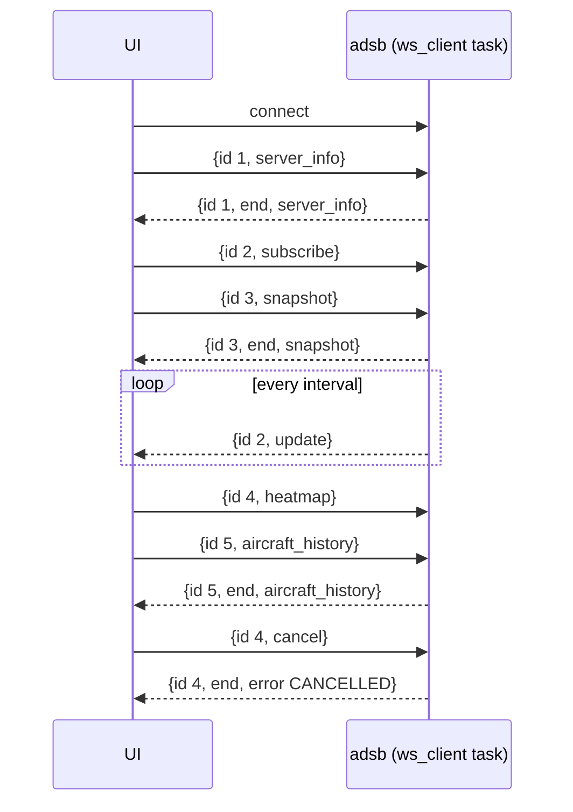

# UI API: protobuf calls over the WebSocket

Status: implemented.

This replaces the JSON between `adsb` and the UI with protobuf messages defined in one `.proto` file, and
turns everything the UI and `adsb` say to each other into calls. A call is a request message with an id,
answered by one reply or by a stream of them, each carrying the same id. It's gRPC's model of named calls
with typed inputs and outputs, carried on coro's WebSocket. Old formats aren't kept: the history database,
the wire format and the UI change together.

What it buys:

1. **One definition of every message.** C++ and Dart both use code generated from the `.proto`, so a
   mismatch fails to compile instead of showing up as a null field in the UI.
2. **Handlers that know nothing about the transport.** A handler is a plain coroutine that takes its
   request message. Whether it returns one reply or a stream of them decides what kind of call it is. A
   test calls it directly, with no socket.
3. **A routing table the compiler checks.** Each call is a case of one `oneof`. The server switches on it
   with no `default`, so `-Wswitch` flags a call that has no handler.
4. **Room to grow.** A new call is a request message, a reply message, one `oneof` case on each side, and a
   `Handle()` overload.
5. **Smaller messages.** The spectrum's 1024 bins go out as packed floats, and frame payloads as bytes,
   not hex strings.

The server borrows its shape from coro's gRPC example (`examples/grpc/include/grpc_server.h`), with
the changes described in [What we take from coro's gRPC example](#what-we-take-from-coros-grpc-example).

## gRPC, or calls over the WebSocket

**Recommendation: our own calls over coro's WebSocket.** The calls are designed so that moving to gRPC
later would keep every message unchanged.

- **Real gRPC doesn't reach the browser.** The UI builds for web as well as Linux. Browsers can't speak
  gRPC's HTTP/2 framing, so a web build needs gRPC-Web and a proxy (Envoy or similar) in front of the
  server, or a server that speaks gRPC-Web itself.
- **The server side would be fine.** coro's `examples/grpc` (`GrpcServer` in `grpc_server.h`) already
  runs an async gRPC server on the runtime. It drains the completion queue on a `spawn_blocking` thread and
  runs each call as a coroutine, for all four call patterns. The cost there is only the dependency: Conan's
  `grpc` brings c-ares, re2 and OpenSSL with it.
- **Connect,** gRPC's browser-friendly cousin, has a Dart client but no C++ server. We'd be writing one on
  top of an HTTP server that coro doesn't have.

The `.proto` has no `service` block. The `oneof` in the envelope is the list of calls, and a `service` block
would be a second list to keep in step with it. If a non-browser client (Python tooling, `grpcurl`) ever
wants a real gRPC endpoint, it can sit beside the WebSocket, built on coro's example, using the same messages
and the same `Handle()` overloads. The `service` block is written then.

## The protocol

Every WebSocket message is one binary frame holding one serialized envelope: a `ClientMessage` from the UI,
or a `ServerMessage` from `adsb`. Text frames are refused (logged and dropped).

**Everything is a call.** Nothing is sent unasked. On connect, the UI calls `server_info` to learn what this
server offers, `subscribe` for live updates, and `snapshot` for the history if there is one.

**Four kinds of call:**

- **Unary:** one request, one reply. `server_info`, `capture` and the history queries.
- **Server streaming:** one request, then replies until the server ends the call or the client cancels it.
  `subscribe`, whose replies are the live updates, and `spectrum`.
- **Client streaming:** requests until the client ends its side, then one reply.
- **Bidirectional:** requests and replies, each side ending its own.

The server supports all four, though no call streams from the client yet. See
[Client streams](#client-streams) for how a client sends one.

**The rules:**

- **Ids strictly increase** within a connection, starting at 1. The UI uses a counter. The server rejects
  a new call whose id isn't larger than the last one it saw with `INVALID_ARGUMENT`. Since an id is never
  reused, a late message about a finished call can never be mistaken for a newer one. A cancel, and a
  client stream's later messages, carry the id of the call they belong to.
- **Every call ends with exactly one message marked `end`.** It's the reply of a unary call, or the last
  message of a stream. That message holds a reply, an `Error`, or, for a stream that simply finished,
  nothing. The UI can clear its record of a call on `end`, whatever else the message holds.
- **A cancel is a `ClientMessage` whose `call` is `cancel`,** with the id of the call to cancel. It gets no
  reply of its own. The cancelled call ends with a `CANCELLED` error, unless its `end` was already on its
  way, in which case the cancel is ignored.
- **A connection may have up to `kClientCalls` (8) calls in progress.** One more is refused at once with
  `RESOURCE_EXHAUSTED`. The server always keeps reading, so a cancel always gets through.
- **Replies come back in the order they finish,** not the order they were asked. The id is what pairs them,
  so the UI no longer filters `aircraft_history` replies by ICAO address.
- **The same call can be in progress several times at once,** with different requests: two snapshots at
  two times, say, are two ids, two tasks and two replies. Each side keeps a map from id to whatever waits
  for the call: a `Completer` in the UI, the call's task in `adsb`.
- **A stream's messages arrive in the order they were sent.** The WebSocket runs over TCP, so the protocol
  has no sequence numbers. Order is the sender's job, and the server gets it for free: one task produces
  a stream one item at a time, and one writer sends everything in the order it was queued. A handler that
  computes its items concurrently puts them back in order before it yields them.
- **A request and its reply share a field number** in their `oneof`s, so the pairs read straight across.



### The `.proto`

`proto/adsb/api/v1/api.proto`. It's a sketch for review: names and numbers are settled at implementation.

```proto
syntax = "proto3";

package adsb.api.v1;

// ---- Envelopes ----

message ClientMessage {
  // A new call's: larger than every earlier id on this connection. For cancel, the call to cancel; for a later
  // message of a client-streaming call, that call.
  uint32 id = 1;
  bool end = 15;  // a client-streaming call's last message: the client sends no more on it
  oneof call {    // unset only on an `end` with no last request
    Cancel cancel = 2;
    ServerInfoRequest server_info = 3;
    SubscribeRequest subscribe = 4;
    SnapshotRequest snapshot = 10;
    AircraftHistoryRequest aircraft_history = 11;
    ActivityRequest activity = 12;
    HeatmapRequest heatmap = 13;
  }
}

message ServerMessage {
  uint32 id = 1;  // the call this belongs to
  bool end = 2;   // the call's last message
  oneof body {    // unset only on the end of a stream that finished normally
    Error error = 9;  // always with end
    ServerInfo server_info = 3;
    Update update = 4;
    Snapshot snapshot = 10;
    AircraftHistory aircraft_history = 11;
    Activity activity = 12;
    Heatmap heatmap = 13;
  }
}

message Cancel {}

message Error {
  enum Code {
    CODE_UNSPECIFIED = 0;
    UNIMPLEMENTED = 1;       // a call this server doesn't know
    INVALID_ARGUMENT = 2;    // e.g. an id not larger than the last, an empty heatmap area, or a client stream's
                             // message for another kind of call
    NO_HISTORY = 3;          // a history call without --history-db
    INTERNAL = 4;            // the handler failed; the server logged why
    CANCELLED = 5;           // the client cancelled it
    RESOURCE_EXHAUSTED = 6;  // kClientCalls calls already in progress, or a client stream sent too far ahead
  }
  Code code = 1;
  string message = 2;
}

// ---- Server info and live updates ----

message ServerInfoRequest {}

message ServerInfo {
  bool history = 1;   // the history calls are answered
  bool spectrum = 2;  // a subscription can carry spectrum rows
  double default_interval_s = 3;  // --ws-interval
}

message SubscribeRequest {
  optional double interval_s = 1;  // unset for --ws-interval; at least kMinUpdateIntervalS
  bool spectrum = 2;               // include spectrum rows, when the server has them
}

// One reply of a subscription: what was published since its last update. Frames and spectrum rows are in
// the order they were published; aircraft are those that changed since the last update, each as last
// published. The first update has every aircraft heard in the last 600 s.
message Update {
  repeated Frame frames = 1;
  repeated SpectrumRow spectrum = 2;
  repeated Aircraft aircraft = 3;
  InputStatus input_status = 4;  // set only when it changed
}

message Frame {
  uint64 idx = 1;  // stream sample index of the preamble
  uint32 bits = 2;
  float confidence = 3;
  uint32 df = 4;
  optional uint32 icao = 5;  // unset when the address isn't known
  bool crc_ok = 6;
  bool crc_checked = 7;  // false for DF19/22
  optional uint32 crc_fixed_bit = 8;
  bytes payload = 9;  // bits / 8 bytes, first bit in the top bit of byte 0
  string summary = 10;  // empty when there's none
}

message SpectrumRow {
  double freq_hz = 1;
  double rate_hz = 2;
  repeated float bins_db = 3;
}

message InputStatus {
  double window_s = 1;
  double rate_hz = 2;
  double stream_s = 3;
  double lost_s = 4;
  double dropped_s = 5;
  optional uint64 kernel_drops = 6;
  bool ok = 7;
  string summary = 8;
}

message Aircraft {
  uint32 icao = 1;
  optional string callsign = 2;
  optional string category = 3;
  optional string squawk = 4;
  optional int32 altitude_ft = 5;
  optional double lat = 6;
  optional double lon = 7;
  optional double ground_speed_kt = 8;
  optional double track_deg = 9;
  optional int32 vertical_rate_fpm = 10;
  optional double heading_deg = 11;
  optional int32 ias_kt = 12;
  optional int32 tas_kt = 13;
  optional double mach = 14;
  optional double roll_deg = 15;
  optional bool on_ground = 16;
  bool alert = 17;
  bool spi = 18;
  optional int32 selected_altitude_ft = 19;
  enum AltitudeSource {
    ALTITUDE_SOURCE_UNSPECIFIED = 0;
    MCP = 1;
    FMS = 2;
  }
  optional AltitudeSource selected_altitude_source = 20;
  optional double selected_heading_deg = 21;
  optional double baro_setting_hpa = 22;
  AutopilotModes autopilot_modes = 23;  // unset until target state arrives
  optional int32 adsb_version = 24;
  optional int32 nac_p = 25;
  optional int32 sil = 26;
  uint64 messages = 27;
  optional double signal_db = 28;
  double last_seen_s = 29;
  double last_seen_unix_s = 30;
}

// Wrapped so that "not known yet" (unset) differs from "none engaged" (empty).
message AutopilotModes {
  enum Mode {
    MODE_UNSPECIFIED = 0;
    AP = 1;
    VNAV = 2;
    ALT = 3;
    APP = 4;
    LNAV = 5;
  }
  repeated Mode modes = 1;
}

// ---- History calls ----

message SnapshotRequest {
  optional double t = 1;  // Unix s; unset for the latest
}

message Snapshot {
  double t = 1;
  optional double t_min = 2;  // the database's span; unset when it's empty
  optional double t_max = 3;
  message Entry {
    Aircraft state = 1;
    repeated TrackPoint track = 2;  // oldest first
  }
  repeated Entry aircraft = 4;
}

message TrackPoint {
  double lat = 1;
  double lon = 2;
  optional int32 altitude_ft = 3;
}

message AircraftHistoryRequest {
  uint32 icao = 1;
  optional double t = 2;  // unset for its latest update
}

message AircraftHistory {
  double t = 1;
  message Point {
    double t = 1;
    optional int32 altitude_ft = 2;
    optional double ground_speed_kt = 3;
    optional int32 vertical_rate_fpm = 4;
    optional double signal_db = 5;
    optional int32 selected_altitude_ft = 6;
  }
  repeated Point points = 2;  // oldest first
}

message ActivityRequest {
  optional double from = 1;  // unset for the whole database
}

message Activity {
  double bucket_s = 1;
  optional double t0 = 2;  // unset when there are no buckets
  repeated uint32 counts = 3;
}

message HeatmapRequest {
  double west = 1;
  double south = 2;
  double east = 3;
  double north = 4;
  uint32 width = 5;
  uint32 height = 6;
  optional double t0 = 7;
  optional double t1 = 8;
}

message Heatmap {
  uint32 max = 1;
  // The nonzero cells: row-major index (row 0 at the north) and flight count, one pair per position.
  repeated uint32 cell_index = 2;
  repeated uint32 cell_count = 3;
}
```

Choices in the sketch worth a look:

- **ICAO addresses are `uint32`,** not hex strings. The UI formats them for display.
- **Times stay `double` Unix seconds,** as today. `google.protobuf.Timestamp` would be two integers to do
  arithmetic on, everywhere the UI scrubs or diffs times.
- **64-bit integers are only where they're needed:** `Frame.idx`, `Aircraft.messages`,
  `InputStatus.kernel_drops`. Dart represents them with `Int64` from `fixnum`, which works on web.
- **Replies don't echo their requests.** The heatmap reply today repeats its area and times, so the UI can
  tell which request it answers. The id does that now.
- **`Update` groups by kind.** Today's update interleaves frames and spectrum rows in published order. The
  UI handles them separately, so nothing depends on that.

### Client streams

A client-streaming or bidirectional call is several `ClientMessage`s with the call's id:

- **The first starts the call,** with a new id, as any call does.
- **Each later one carries the next request** in the same `oneof` case. One for another kind of call fails
  the call with `INVALID_ARGUMENT`.
- **`end` is the client's half-close.** The message that sets it may carry a last request, or none, with
  `call` unset. A call whose first message sets `end` has just the one request.
- **The server queues up to `kCallInputQueue` (16) requests** for the call's handler. A client that sends
  more before the handler takes them has its queue closed: the call fails with `RESOURCE_EXHAUSTED` once it
  has handled the 16. The reader never waits for room, so a full queue can't hold back the connection's
  other calls, or a cancel.
- **A later message for a call that takes no more input,** one that doesn't stream from the client or has
  already sent `end`, is logged and dropped. A reply with its id would collide with the call's own `end`.

## The server

All of it is in `src/output/api_server.cpp`, replacing `ws_publisher.*`. Its header has only what the rest
of the program uses: the channels the pipeline publishes on, and `api_server_spawn()`. Everything else is
in the `.cpp`'s anonymous namespace, in this order:

- **`ApiHandlers`:** the calls, as `Handle()` overloads. They know nothing of the transport.
- **`ADSB_API_CALLS`:** the list of calls, an X-macro.
- **`ApiConnection`,** one per connection: the reader and the single writer, the routing, the calls in
  progress and their cancellation, and the turning of handlers' results into replies.
- **The listener,** with one task per connection.

The handlers come first, as the part a new call adds to. coro's gRPC example keeps its handlers apart from
its transport for the same reason.

### Handlers

A handler is a coroutine member of `ApiHandlers` that takes its request, or a stream of them. What it takes
and what it returns decide what kind of call it serves. Every handler is called `Handle`: the requests are
all different message types, so they overload on the parameter.

| Call kind | Handler |
|---|---|
| unary | `coro::Coro<Reply> Handle(const Request&)` |
| server streaming | `coro::CoroStream<Reply> Handle(const Request&)` |
| client streaming | `coro::Coro<Reply> Handle(coro::CoroStream<Request>)` |
| bidirectional | `coro::CoroStream<Reply> Handle(coro::CoroStream<Request>)` |

```cpp
// Every call runs in a task of its own, so a handler takes its own clone of anything that is for one task
// at a time.
class ApiHandlers {
public:
    struct Settings {
        std::chrono::nanoseconds default_interval;  // --ws-interval
        bool live;                                  // whether a pipeline publishes on the channels
        bool capture;                               // whether the pipeline takes capture calls
    };

    ApiHandlers(ApiReceivers live, std::optional<AircraftHistory> history, Settings settings);

    coro::Coro<api::ServerInfo> Handle(const api::ServerInfoRequest&);
    coro::CoroStream<api::Update> Handle(const api::SubscribeRequest&);
    coro::CoroStream<api::SpectrumRow> Handle(const api::SpectrumRequest&);
    coro::Coro<api::CaptureResult> Handle(const api::CaptureRequest&);
    coro::Coro<api::Snapshot> Handle(const api::SnapshotRequest&);
    coro::Coro<api::AircraftHistory> Handle(const api::AircraftHistoryRequest&);
    coro::Coro<api::Activity> Handle(const api::ActivityRequest&);
    coro::Coro<api::Heatmap> Handle(const api::HeatmapRequest&);

private:
    ApiReceivers m_live;
    std::optional<AircraftHistory> m_history;
    Settings m_settings;
};
```

- **A handler fails by throwing.** `CallError{code, message}` becomes that `Error`, such as `NO_HISTORY`
  or `INVALID_ARGUMENT`. Any other exception is logged and becomes `INTERNAL`. The return types stay plain
  replies, as in coro's example.
- **The history calls are a few lines each:**

    ```cpp
    if (!m_history) throw CallError(api::Error::NO_HISTORY, "the server has no history database");
    AircraftHistory db = m_history->clone();
    auto reply = co_await db.snapshot(request);
    if (!reply) throw CallError(api::Error::INTERNAL, "the history query failed");  // the history task logged why
    co_return std::move(*reply);
    ```

    The `AircraftHistory` queries take request messages and return replies, built on the actor's thread.
    A query returns `nullopt` when it fails, which the handler turns into `INTERNAL`. The history code
    knows nothing of the API's error codes.

### Routing

All the routing is in one loop, the connection's reader, `read_socket()`. It decodes each binary message as
a `ClientMessage` and acts on it in this order:

1. **A `cancel`** cancels the call its id names.
2. **An id of a call in progress** is a client stream's later message. The reader passes it whole to the
   call's input queue with `try_send()`, and the call's own task unwraps it.
3. **Anything else is a new call.** A `switch` on its `call_case()` starts it, or refuses it.

The `switch` is generated from one list of the calls, `ADSB_API_CALLS`, one line per call:

```cpp
#define ADSB_API_CALLS(CALL)                                         \
    CALL(kServerInfo, server_info, ServerInfoRequest)                \
    CALL(kSubscribe, subscribe, SubscribeRequest)                    \
    ...
    CALL(kCapture, capture, CaptureRequest)

switch (msg.call_case()) {
#define ADSB_START_CALL(CASE, FIELD, TYPE) \
    case api::ClientMessage::CASE: refused = start(std::move(*msg.mutable_##FIELD())); break;
    ADSB_API_CALLS(ADSB_START_CALL)
#undef ADSB_START_CALL
case api::ClientMessage::kCancel: break;  // handled above
case api::ClientMessage::CALL_NOT_SET:    // a call newer than this server, or none at all
    refused = error_message(id, api::Error::UNIMPLEMENTED, "unknown call");
    break;
}
```

- **No `default`,** so a call added to the `.proto` and missing from the list is a `-Wswitch` warning.
- **A call refused at once,** for its id or the cap, gets its `Error` from the reader.
- **`start()` is written once,** as a generic lambda over the request type. It refuses a repeated id or one
  over the cap, then spawns the call's task. A call whose handler takes a stream of requests gets them from
  a queue of its own; any other gets its request.
- **A call's kind comes from two facts about its `Handle`:** whether it takes a request or a stream of them
  (`kTakesStream`), and whether it returns a `coro::Stream` (`kReturnsStream`). They pick one of four
  `run_call()` overloads, one per kind:
    - a unary or client-streaming call awaits the handler and returns its reply;
    - a server-streaming or bidirectional call sends each item the handler yields, and returns an empty
      message;
    - each takes its request, or stream of requests, by value, so it lives in the call's own frame for the
      handler to read.
- **A call's task returns its last message,** for the reader to send as the call's `end`. It never sends its
  own `end`; see [Calls in progress and cancellation](#calls-in-progress-and-cancellation).
- **`put()` puts a reply in its envelope.** A small overload set, `put(api::ServerMessage&, api::Snapshot)`
  and so on, picks the `body` case. A reply type without one is a compile error.
- **A handler that doesn't exist for a request** is a compile error in `start()`, at the line of the list
  that names it.

### Calls in progress and cancellation

The reader keeps the calls' tasks in a JoinSet, each tagged with its call's id, and a map of the calls in
progress beside it. Both are locals of `read_socket()`:

```cpp
struct Call {
    coro::CancelHandle task;
    // A client stream's input, until the client's `end` or a full queue closes it; unset for other calls.
    std::optional<coro::MpscSender<api::ClientMessage>> in;
    bool notable = false;  // logged at INFO, not VLOGF(1)
};
coro::JoinSet<api::ServerMessage, uint32_t> tasks;  // each tagged with its call's id
std::unordered_map<uint32_t, Call> active;           // each call until read_socket() has its outcome
```

- **The reader sends every call's `end`,** from the call's outcome, so no call can miss it by failing or
  being cancelled. It selects between the socket and the JoinSet's next outcome. When one arrives, its tag
  names the call, and the reader erases the call from `active` and sends the `end`:
    - **finished:** the message the task returned, a unary call's reply or a stream's empty `end`;
    - **failed:** an `Error`, with a `CallError`'s code, or else `INTERNAL`;
    - **cancelled:** `CANCELLED`.
- **The `end` follows the call's other messages.** The task sent them on the writer's queue before it
  finished, and the reader sends the `end` on the same queue after.
- **A cancel** calls the call's `CancelHandle`, which stops the handler at its next `co_await`. A cancel
  that arrives after the task finished, before the reader has its outcome, changes nothing: the call ends
  as it finished. An id that isn't in `active` is ignored, since its `end` is already queued.
- **On disconnect,** `read_socket()` throws and its frame is destroyed. The JoinSet's destructor cancels
  every task still in progress and drains them. Nothing is left to send to.
- **The JoinSet is a local, not a member,** because the calls' tasks use the connection. However
  `read_socket()` ends, its frame is destroyed and the tasks are drained while the connection still exists.
  For the same reason the connection is a parameter of the connection's task, `serve()`, not a local: a
  parameter is destroyed after that drain, a local before it. As a member, the set would be dropped with
  the connection, and the tasks drained after it was gone.
- **The cap** is the size of `active`: a new call with `kClientCalls` calls in progress fails at once with
  `RESOURCE_EXHAUSTED`. A call counts until the reader has its outcome. A cancel gets through even at the
  cap: the reader waits only to queue the `end`s and its own refusals, so only a client that stops reading
  replies holds it back.

### One writer per connection

Every call sends its serialized `ServerMessage`s into one bounded channel, `kWriteQueue` (16) deep, as does
the reader with each `end` and refusal. The connection's writer, `write_socket()`, is the only one that
sends on the socket, in the order they were queued. It runs beside the reader in the connection's task,
joined with `coro::join()`, so whichever throws first, on a disconnect or a send timeout, cancels the
other.

- **The waiting happens in each call's own task.** Calls run in the background for as long as they take,
  and the reader goes on reading and starting calls. When the client reads slowly, the channel fills, and a
  call waits at its next send: a streaming call's handler waits at its next `co_yield`, as in coro's gRPC
  example, which doesn't ask a stream for its next reply until the previous write has finished. A unary
  call is one message, so it's barely held back. Nothing is buffered without bound and nothing is dropped.
- **A send that takes over `kSendTimeout` (20 s) closes the connection.** It's only for a client that has
  stopped reading, whose calls would otherwise stay parked until TCP gives up, many minutes later. It's
  long enough never to fire on one that's just slow. Messages aren't dropped instead, since a dropped `end`
  would leave the UI waiting forever. Closing ends every call at once, and the UI reconnects.

### Live updates: the subscribe handler

`Handle(const api::SubscribeRequest&)` is a `CoroStream<api::Update>`. It's today's per-client collecting
and diffing, written as one loop:

```cpp
coro::CoroStream<api::Update> Handle(const api::SubscribeRequest& request) {
    auto live = m_live.live.resubscribe();
    auto aircraft = m_live.aircraft.clone();
    auto status = m_live.input_status.clone();
    coro::IntervalTimer timer(interval(request));
    LiveAircraft sent_aircraft;
    std::optional<api::InputStatus> sent_status;
    api::Update update;
    for (;;) {
        auto woke = co_await coro::select(live.recv(), timer.tick());
        if (woke.index() == 0) {
            // add the frames, or the spectrum row if request.spectrum(), to update; on Lagged, log and plot
            continue;
        }
        // copy both watches, add what differs from sent_aircraft and sent_status, keep the copies
        if (has_anything(update)) co_yield std::exchange(update, {});
    }
}
```

- **One loop, no `join()`.** Today a collector task and a sender task share `Pending`. Here the stream
  receives between ticks, and yields at a tick.
- **The broadcast's ring is the buffer.** While the client is slow, the handler is held at its `co_yield`
  and stops receiving. The 64-item ring then fills, and the receiver reports `Lagged` and skips the oldest.
  This is the same drop as today's pending cap, which drops the oldest text over
  `ADSB_WS_MAX_PENDING_BYTES`. The ring makes the cap, and that environment variable, unnecessary.
- **The channels don't change:** a broadcast of frames and spectrum rows, a watch of aircraft and a watch
  of the input status, made by `main.cpp` as now. Their types do:
    - `live` carries `shared_ptr<const std::vector<api::Frame>>` or `shared_ptr<const api::SpectrumRow>`;
    - `LiveAircraft` is `std::unordered_map<uint32_t, api::Aircraft>`. `PublishedAircraft` goes away, the
      600 s window uses `last_seen_unix_s()`, and the diff uses
      `google::protobuf::util::MessageDifferencer::Equals`;
    - the status watch holds `std::optional<api::InputStatus>`, not JSON. `main.cpp` converts the
      `InputStatus` to its proto, so `adsb_output` still doesn't need `adsb_input`.
- **The interval** is the request's, or `--ws-interval` when unset. Anything under `kMinUpdateIntervalS`
  (0.1 s) is raised to it, logged at INFO. Over `kMaxUpdateIntervalS` (an hour), or NaN, is
  `INVALID_ARGUMENT`: converting it to nanoseconds would overflow.
- **Serialization stays per client,** in each call's task: its `ws_serialize` zone covers
  `SerializeAsString`, before the message is queued for the writer.
- **Several subscriptions on one connection** are allowed, each a call of its own.

### What we take from coro's gRPC example

- **The handler's signature decides the kind of call,** and the handler never sees the transport.
- **One adapter per kind of call,** written once and picked at compile time (`HandleNextRequest`'s tag
  dispatch there, the constraints on the `run_call()` overloads here).
- **Writes paced by the client:** a stream isn't asked for its next item until the last one is on its way.
- **A task per call,** as both designs already have.

And where we differ:

- **Registration is the `oneof` switch,** generated from `ADSB_API_CALLS`, not method pointers, since there
  is no generated service.
- **One handler name.** The example needs `Handle`, `Generate` and `Process`, because a gRPC method pointer
  fixes the parameter types and C++ can't overload on return type alone. Our requests are all different
  types, so every handler can be `Handle`.
- **Per-call cancellation and an error path.** The example finishes every call with `Status::OK`, and its
  own comments leave cancellation for later.
- **Finished calls are reaped.** As far as I can tell, the example's `m_join_set` is never drained, so
  finished calls collect there for the server's lifetime. That's worth fixing in coro, separately.
- **A multi-threaded runtime.** The example shares `m_request_count` unlocked because it runs on a
  single-threaded executor. Here, state shared between handlers goes through actors and channels.

### Where the conversions live

A new library, `adsb_api` (`src/api/`), holds the generated code and the conversions:
`to_proto(const AircraftState&)`, `to_proto(const DecodedFrameView&, std::string summary)` and
`to_proto(const SpectrumFrame&)`. The decode and DSP libraries keep no protobuf dependency.
`InputStatus`'s conversion goes in `main.cpp`, so `adsb_api` doesn't need `adsb_input`.

The JSON `to_json` overloads for frames, aircraft and spectrum stay, though nothing calls them now.
`nlohmann_json` stays as a dependency: SigMF metadata and the simulator use it.

## Pipeline settings

Status: implemented, but for [Later: settings a client sets](#later-settings-a-client-sets).

The spectrum becomes a call: the pipeline computes it only while at least one client is watching the
waterfall, and `--spectrum` goes. The mechanism is a watch of settings that the server writes and the
pipeline's tasks read. It's the groundwork for settings a client sets, such as the frequency and sample
rate, described in [Later: settings a client sets](#later-settings-a-client-sets).

### The settings watch

```cpp
// output/api_server.h

/** What the pipeline's tasks are asked to do, written by the API server. */
struct PipelineSettings {
    int spectrum_viewers = 0;  /**< spectrum calls in progress; the spectrum tap computes while above 0 */
};
```

- **One watch per pipeline,** made by `api_channels()` beside the other three channels. The struct goes in
  `api_server.h`, since `adsb_output` can't see the app's `pipeline.h`.
- **The server holds the sender.** Each connection gets a clone, as it does the receivers today, and a
  call that writes takes a clone of its own: a `WatchSender` is for one task at a time.
- **Every write is a `send_if_modified()`,** a read-modify-write under the watch's lock, so writes from
  calls on different threads can't lose each other. A write that changes nothing wakes no one.
- **The pipeline's tasks hold receivers.** A task reads its setting with `borrow()` where its loop already
  pauses, as the spectrum tap does once per `kSpectrumInterval`. A task that has to react at once, as a
  retune would, selects on `changed()` instead.
- **The channel structs gain one end each,** running the other way from their names:
  `ApiReceivers::settings` is the server's `WatchSender`, and `ApiSenders::settings` is the pipeline's
  `WatchReceiver`. Decision 12 proposes names that say which side holds them.
- **Without a pipeline,** in `serve` mode, the server still has a sender, with no receivers. Writes to it
  succeed and change nothing, and `ServerInfo.spectrum` is false, so the UI doesn't ask.

### Spectrum

**The call.** A server-streaming call whose replies are the spectrum rows, one message per row:

```proto
// ClientMessage's oneof
SpectrumRequest spectrum = 5;
// ServerMessage's body
SpectrumRow spectrum = 5;

message SpectrumRequest {}
```

- `SubscribeRequest.spectrum` and `Update.spectrum` go: a subscription never carries spectrum rows.
- `ServerInfo.spectrum` now says the spectrum call is answered: true whenever there's a pipeline.
- A new error code, `NO_LIVE_INPUT`, answers the spectrum call in `serve` mode, as `NO_HISTORY` answers a
  history call without a database.

**The handler.** The call counts itself in `spectrum_viewers` for as long as it lives:

```cpp
coro::CoroStream<api::SpectrumRow> Handle(const api::SpectrumRequest&) {
    if (!m_settings.live) throw CallError(api::Error::NO_LIVE_INPUT, "the server has no live input");
    auto live = m_live.live.resubscribe();
    coro::WatchSender<PipelineSettings> settings = m_live.settings.clone();
    settings.send_if_modified([](PipelineSettings& s) {
        ++s.spectrum_viewers;
        return true;
    });
    coro::Defer uncount([&settings] {
        settings.send_if_modified([](PipelineSettings& s) {
            --s.spectrum_viewers;
            return true;
        });
    });
    for (;;) {
        auto item = co_await live.recv();
        // on Lagged: log and plot, as the subscription does; on closed: co_return
        if (auto* row = std::get_if<std::shared_ptr<const api::SpectrumRow>>(&*item)) co_yield **row;
    }
}
```

- **The `coro::Defer` is a local of the handler's frame,** so the count comes down however the call ends:
  its own end, a cancel, the connection closing, or the send timeout. Each of those destroys the frame.
- **The rows stay on the `live` broadcast,** beside the frames, and the handler skips the frames. Splitting
  them onto a channel of their own isn't needed for this: the watch, not the channel, gates the work.
- **`ApiHandlers::Settings::spectrum` becomes `live`:** whether there's a pipeline. `api_server_spawn()`'s
  `spectrum` parameter becomes `live` too.

**The branch.** When there's a server, the tee in front of `demodulate()` sends a share of each block to the
spectrum's own task, `publish_spectrum()`, which takes a clone of `ws->settings`. Its `while_viewed()` reads
`spectrum_viewers` at most once per `kSpectrumInterval`, and at 0 drops the blocks before the FFTs. When
nobody is watching, the cost is that read, a shared lock every 50 ms, and a share of each block.

- **The check races with a call starting or ending,** which is harmless: a new viewer may wait one interval
  for its first row, and the last viewer's going may let one more row be computed and dropped.
- **It logs at INFO** when it starts and stops computing, with the viewer count, since that is the
  run's state. Each spectrum call's start and end are logged at INFO, like every streaming call's.
- **`--spectrum` goes,** with `DemodLoopParams::enable_spectrum`, and the README's option row with it.

**The UI.** `ApiClient` gains `Stream<SpectrumRow> spectrum(SpectrumRequest)`.

- **The Spectrum toggle in the top bar opens and closes the call.** Showing the pane starts the call, and
  hiding it cancels the call's `StreamSubscription`, which sends the cancel. A reconnect while the pane is
  shown starts it again.
- **The toggle is shown only when `ServerInfo.spectrum` is true.** Today it's always shown, and in `serve`
  mode it opens an empty pane.
- **`_onUpdate` no longer handles spectrum rows.** The call's listener appends to `_spectrumHistory`
  instead, with the same cap of 150 rows.

### Capture

**The call.** A unary call that records one point of the pipeline to a SigMF recording on the server, and
replies when the recording has covered its duration:

```proto
// ClientMessage's oneof
CaptureRequest capture = 14;
// ServerMessage's body
CaptureResult capture = 14;

message CaptureRequest {
  enum Point {
    POINT_UNSPECIFIED = 0;
    INPUT = 1;     // the input IQ after stitching, as the source delivered it: replayable with `adsb file`
    ENVELOPE = 2;  // the demodulator's resampled envelope magnitude, real float32 at its output rate
  }
  Point point = 1;
  double duration_s = 2;  // stream time; over 0, and at most ServerInfo.capture_max_s
  string name = 3;        // file name in --capture-dir: no '/', not starting with '.'; .sigmf-data/-meta added
}

message CaptureResult {
  string data_path = 1;
  string datatype = 2;     // SigMF core:datatype, e.g. "cf32_le"
  double rate_hz = 3;
  uint64 start_index = 4;  // the point's stream index of the first sample
  uint64 samples = 5;      // samples written
  uint64 missing = 6;      // samples of the duration not written
}
```

- **`--capture-dir` turns it on.** `ServerInfo.capture` says the call is answered, and
  `ServerInfo.capture_max_s` is the longest it takes, 60 s (`CaptureCall::kMaxDurationS`). Without the option
  the call fails with `NO_CAPTURE`.
- **A capture never overwrites a file.** The name is a bare file name, and a call for one that exists fails
  with `INVALID_ARGUMENT`.
- **One capture per point at a time.** A second call for the same point fails with `RESOURCE_EXHAUSTED`; the
  input and the envelope can be captured at once.
- **Cancelling the call stops the capture,** and keeps what it has written, with metadata that matches it.
  So does the connection closing. Either way there's no reply to carry the result.

**The points.**

- **`INPUT`** is each block's own samples after `stitch()`, in the block's format: `cf32_le`, or `ci16_be`
  from a VITA 49 source. It's `adsb file`'s input, at the input rate and center frequency, and its indexes
  are `Frame.idx`'s.
- **`ENVELOPE`** is the magnitude `demodulate()` resamples to its output rate (`demod_output_rate_hz()`,
  12 Msps), as `rf32_le`. Each block owns the outputs up to its last scan position, so the runs join without
  overlap.

**The pipeline.** With `--capture-dir`, `run_demod_loop()` adds two capture tasks (`output/capture.h`) and a
router that hands each call from `ApiSenders::captures` to its point's task, over a channel with a oneshot for
the reply.

- **The input task is a branch of the tee,** beside the spectrum's. It drops blocks it is behind on, like any
  branch, so a slow disk loses samples rather than slowing the demodulator.
- **The envelope task is fed by the sink,** which sends it each block's envelope with `try_send`. A copy of
  the envelope is 48 MB/s, so `demodulate()` makes one only while an envelope capture is in progress: the
  task sets a `watch<bool>` that `demodulate()` reads once per block.
- **A gap starts a new SigMF capture segment,** whose `core:global_index` says where the samples resume. It
  is logged at WARNING, at most once a second, and plotted (`capture input missing`, `capture envelope
  missing`). `CaptureResult.missing` totals them.
- **The metadata is written when the first samples arrive, at each new segment, and at the end,** so a
  capture cut short by Ctrl+C has metadata for all it wrote.
- **No file is opened exclusively:** `coro::File` has no `O_EXCL`, so the task checks that neither file
  exists first. Only two captures of the same name racing each other get past the check.
- **Each capture's start and end are logged at INFO,** with its path, sample count and samples missing.

**The UI.** `ApiClient` gains `Stream<CaptureResult> capture(CaptureRequest)`. It is a stream, though the call
is unary, so cancelling its subscription cancels the call.

- **A capture button in the top bar** is shown while connected to a server whose `ServerInfo.capture` is
  true. It opens a dialog for the point, the duration (up to `capture_max_s`) and the name, which defaults to
  `capture_<date>_<time>`.
- **While a capture is in progress,** the button is replaced by its progress, timed by the wall clock, and a
  stop button that cancels the call.
- **A SnackBar reports the result:** the path, samples, duration and samples missing, or the error.

### Later: settings a client sets

Frequency and sample rate are the likely first ones: values a client sets, not demand from several of them.
They fit the same watch:

- **`PipelineSettings` gains the values,** filled from the options at startup.
- **A unary `set_settings` call** whose request has each setting as an `optional` field. The server
  validates what's set and writes it with `send_if_modified()`. Last write wins.
- **A streaming `settings` call** whose first reply is the current settings and whose next ones are each
  change, from a receiver's `changed()`. A client that sets a value hears it back through this call, the
  same way every other client does, so all of them stay in sync through one path. The UI updates its
  controls from this stream, never from what it sent.
- **Only what clients set goes out.** `spectrum_viewers` is server-side bookkeeping, so the streamed
  message leaves it out, and a change to the count alone sends nothing: the call compares with what it last
  sent, as the subscription does with aircraft.

Open questions, for when the first such setting is designed:

- **What a change means for each input.** `rtlsdr` can retune. A file can't change its rate. `vita49`
  would have to ask its sender. A rate change also means a new filter bank.
- **What the watch holds: what was asked for, or what's in effect.** A device can refuse a value, or round
  it. If the stream should report what's in effect, the input task writes the applied value back, and the
  pipeline becomes a writer too.
- **Errors.** At startup, a rate the device rejects is fatal, since it would mislabel every sample. At run
  time the set call fails with the reason instead, and the pipeline keeps the old value.

### Changes by file

- `proto/adsb/api/v1/api.proto`:
    - the `spectrum` call and `SpectrumRequest`;
    - `NO_LIVE_INPUT`;
    - `SubscribeRequest.spectrum` and `Update.spectrum` go;
    - `ServerInfo.spectrum`'s comment.
- `src/output/api_server.h`, `.cpp`:
    - `PipelineSettings`, and the watch in `api_channels()`;
    - the settings ends in the channel structs;
    - the spectrum handler;
    - the subscription without spectrum rows;
    - `Settings::live`.
- `src/apps/adsb/pipeline.h`, `.cpp`: the tap reads the watch, and `--spectrum` and `enable_spectrum` go.
- `src/apps/adsb/main.cpp`: `api_server_spawn()` takes `live`.
- `tests/api_server_test.cpp`: the tests below.
- UI: the regenerated Dart, `api_client.dart`, `frame_table_page.dart` (the toggle and the call) and
  `spectrum.dart` if the pane needs to know whether the call is open.
- `README.md`: the `--spectrum` row, the WebSocket section's calls, and the diagram's spectrum arrow.

### Testing (yours to run)

- **The count:** one spectrum call takes `spectrum_viewers` from 0 to 1, and its cancel back to 0. Two
  calls make it 2. A connection closing with a spectrum call in progress brings it back to 0.
- **The rows:** a spectrum call sends the spectrum rows published while it's open, and none of the frames.
  A subscription no longer sends spectrum rows.
- **`serve` mode:** `ServerInfo.spectrum` is false, and the spectrum call gives `NO_LIVE_INPUT`.
- **End to end:** the waterfall fills only while its pane is shown, and with two UIs open, closing the pane
  in one leaves the other's running.

## The history database

The `state` column becomes the serialized `api::Aircraft` as a BLOB. Today the queries read fields out of
the JSON with `json_extract()`. Those fields become columns, filled at insert:

```sql
CREATE TABLE aircraft_updates (
  t REAL NOT NULL,           -- last_seen_unix_s
  icao INTEGER NOT NULL,
  lat REAL,
  lon REAL,
  altitude_ft INTEGER,
  ground_speed_kt REAL,
  vertical_rate_fpm INTEGER,
  signal_db REAL,
  selected_altitude_ft INTEGER,
  state BLOB NOT NULL        -- api::Aircraft
);
```

- **`HistoryRow` becomes the proto,** `api::Aircraft` itself. The actor pulls the columns out of it and
  serializes it on its own thread, so the sink builds each published aircraft once and never serializes it.
- **The queries take request messages and return replies:** `api::Snapshot`, `api::AircraftHistory`,
  `api::Activity` and `api::Heatmap`, built on the actor's thread. A query that fails returns `nullopt`,
  with the reason logged, and the handler sends `INTERNAL`. The heatmap handler refuses an empty area itself,
  with `INVALID_ARGUMENT`, so the history code stays free of the API's error codes.
- **A snapshot parses each aircraft's `state`.** That's a few hundred small parses per snapshot.
- **`icao` becomes an integer,** which makes the indexes smaller too.
- **An old database is refused.** The schema sets `PRAGMA user_version = 2`. `AircraftHistory::open()`
  refuses a file of any other version, with an error naming the file and saying whether it's from an older
  or a newer `adsb`, rather than failing later in a query. Files from before this change have version 0,
  since nothing set it, so a version-0 file is refused too if it already has the table. A new file gets
  version 2.

## The UI

- **Dependencies:** `protobuf` and `fixnum` in `pubspec.yaml`. The Dart generator, `protoc_plugin`, is a
  developer tool, installed with `dart pub global activate protoc_plugin`.
- **Generated code is committed** under `ui/frontend/lib/api/`, so a UI build doesn't need `protoc`. A
  script, `tools/gen_api_dart.sh`, regenerates it with the `protoc` that Conan builds.
- **An `ApiClient` class** owns the WebSocket and gives the UI calls that look like gRPC stubs. Each call
  takes the next id, and a disconnect fails every call still in progress.
    - **Unary:** `Future<Heatmap> heatmap(HeatmapRequest)`. The call parks a `Completer` under its id. The
      reply completes it, and an `Error` completes it with an `ApiException`.
    - **Streaming:** `Stream<Update> subscribe(SubscribeRequest)`. Cancelling the Dart
      `StreamSubscription` sends the call's `cancel`. `end` closes the stream, and an `Error` arrives as a
      stream error.
- **The pages call `ApiClient`** instead of building JSON. The single-flight logic for seek, heatmap and
  activity stays, now awaiting a `Future`. The ICAO filter on `aircraft_history` replies goes. On connect,
  the UI calls `serverInfo()`, then `subscribe()`, then `snapshot()` if `ServerInfo.history` says there's
  a history.
- **The UI's own models.** `models.dart` parses JSON today. The generated classes replace the parsing;
  whether they also replace the models is a decision below.
- **Web:** check whether binary messages arrive as `Uint8List` or `ByteBuffer` there, and accept both.

## Debugging

- **In `adsb`:** at `--verbosity 2`, each connection logs every message it sends and receives as
  `ShortDebugString()`. That's per message, which the logging guidelines put at `VLOGF(2)`. Each
  streaming call's start and end, with its id, kind, request and outcome, are logged at INFO, and each unary
  call's at `--verbosity 1`: the history scrubber makes one per seek.
- **Captures:** `protoc --decode=adsb.api.v1.ServerMessage proto/adsb/api/v1/api.proto < msg.bin` reads
  a saved message.
- **A printing proxy** between the UI and `adsb` is a later, separate tool. It needs nothing from this
  design but the `.proto`.

## Build

- **Conan:**
    - add `protobuf`, at the newest on conancenter, `7.36.2`;
    - add it as a `tool_requires` too, for `protoc` in the build context;
    - keep `abseil/20250127.0`: protobuf's recipe takes Abseil from `20240722.0` to `20260107.1`. `adsb`'s
      own logging uses Abseil directly, so it stays a direct requirement.
- **CMake:** `src/api/CMakeLists.txt` defines `adsb_api`. It runs `protobuf_generate` on
  `proto/adsb/api/v1/api.proto` and links `protobuf::libprotobuf`, `adsb_decode` and `adsb_dsp`.
  `adsb_output` links `adsb_api`.
- **Full protobuf, not lite.** `MessageDifferencer` and `ShortDebugString()` need the full library. The
  extra size doesn't matter for a desktop server.
- **The `proto/` directory** already exists, holding only a stray `CMakeUserPresets.json`. Its fate is
  yours.

## Changes by file

- New:
    - `proto/adsb/api/v1/api.proto`;
    - `src/api/CMakeLists.txt`, `src/api/convert.h`, `src/api/convert.cpp`;
    - `src/output/api_server.h`, `api_server.cpp`;
    - `ui/frontend/lib/api/` (generated) and `ui/frontend/lib/api_client.dart`;
    - `tools/gen_api_dart.sh`.
- Removed: `src/output/ws_publisher.h`, `ws_publisher.cpp` (for you to delete), their channels moving to
  `api_server.h`.
- `conanfile.py`: `protobuf` and its `tool_requires`.
- `CMakeLists.txt`, `src/output/CMakeLists.txt`: the new library and files.
- `src/output/aircraft_history.h`, `.cpp`: the schema and version check, `HistoryRow` as `api::Aircraft`,
  and queries that take requests and return replies, or `nullopt` on failure.
- `src/apps/adsb/pipeline.h`, `.cpp`: `handle_frame()` fills `api::Frame` and `api::Aircraft`; the spectrum
  tap sends an `api::SpectrumRow`.
- `src/apps/adsb/main.cpp`: `InputStatus` to `api::InputStatus`, and the renamed spawn function.
- `src/decode/aircraft.*`, `src/decode/frame_decode.*`, `src/dsp/spectrum.*`: the JSON overloads go.
- UI: `pubspec.yaml`, `frame_table_page.dart` (connection and dispatch), `history.dart`, `heatmap.dart`,
  `models.dart`, and the pages that read the models.
- `README.md`: the WebSocket section describes the calls and points at the `.proto` rather than listing
  JSON fields. `ADSB_WS_MAX_PENDING_BYTES` leaves the environment table. The diagram's `ws_client` box
  gains its call tasks and writer.

## Order of work

Two steps. The first adds the new code beside the old, changing nothing that runs. The second swaps it in.
Old formats aren't kept, so the server and the UI switch together in the second.

1. **Beside the old code:**
    - Conan, the `.proto`, `adsb_api` and its conversions;
    - the server, with a test that drives it as a WebSocket client;
    - the `server_info` and `subscribe` handlers, against channels of their own that nothing publishes on
      yet;
    - the UI's dependencies, the generated Dart, and an `ApiClient` that no page uses yet.
2. **The swap:**
    - the history database and its queries, and the four history handlers;
    - the pipeline and `main.cpp` publishing `api::` types and starting the new server;
    - the pages moving to `ApiClient`, and `ws_publisher.*` and the JSON overloads going.

## Testing (yours to run)

- **Conversions:** a unit test that round-trips an `AircraftState` with every field set, and one with none
  set, through `to_proto()`, checking presence as well as values.
- **History queries:** through the server's history calls, against an in-memory database with rows
  inserted; and the refusal of a file from before the version was recorded, and of one with a newer version.
- **The server, as a WebSocket client:** each test starts the server on a port of its own, connects, and
  publishes on the server's channels:
    - `server_info` answers with the settings, and ends with `end`;
    - a subscription sends what was published, each aircraft only when it has changed;
    - a history call gives `NO_HISTORY` without a database, and an interval over the maximum gives
      `INVALID_ARGUMENT`;
    - a cancel gives `CANCELLED`, after which the subscription sends nothing more, though data is still
      being published; a cancel that arrives after a call's `end` gives no second `end`;
    - the ninth call gives `RESOURCE_EXHAUSTED`, and a cancelled call frees its place;
    - a repeated id gives `INVALID_ARGUMENT`, and an unknown call `UNIMPLEMENTED`;
    - bytes that aren't a `ClientMessage`, and a text frame, are ignored;
    - a client that disconnects with calls in progress doesn't disturb the next.
- **End to end:** the UI on Linux and on web, live and in `serve` mode, with several calls out at once and
  a subscription cancelled and restarted.

## Decisions

1. **Our own calls over the WebSocket, not gRPC.** Recommended, for the reasons above.
2. **Everything is a call,** including server info and the live updates, and nothing is pushed.
   Recommended: one mechanism, and the client chooses what it gets.
3. **All four kinds of call,** each deduced from its `Handle`'s signature, though only unary and server
   streaming have a call yet.
4. **A connection's ninth call is refused,** rather than the reader pausing as it does today. Recommended,
   so a cancel always gets through. `kClientCalls` is 8: a subscription and one of each history call is 5.
5. **Ids strictly increase,** so they're never reused and a stale message can't match a newer call.
6. **A send that takes over 20 s closes the connection,** rather than dropping the message.
7. **The broadcast's ring replaces the pending-bytes cap,** and `ADSB_WS_MAX_PENDING_BYTES` goes.
8. **Generated classes in the UI:** use them directly as the UI's models, or keep `models.dart` as a layer
   built from them. Using them directly removes a layer. Keep the layer only where a model carries UI
   state the protos shouldn't.
9. **`protobuf` 7.36.2,** the newest on conancenter. The current Abseil already fits it.
10. **Commit the generated Dart.** Recommended, so a UI build needs no `protoc`. C++ is generated at build
    time, since Conan provides `protoc` there anyway.
11. **Pipeline settings in a watch the server writes,** read by the pipeline's tasks. Recommended: one
    path for every setting from now on, whether it comes from clients' demand, as the spectrum does, or
    from a client setting a value.
12. **Rename the channel structs** once they carry ends both ways: `ApiSenders` to `ApiPipelineEnds` and
    `ApiReceivers` to `ApiServerEnds`, named for who holds them. Or keep the names, with a comment on the
    one end in each that runs the other way.
13. **The spectrum is a call of its own,** not a flag of the subscription. Recommended: the UI turns the
    waterfall on and off without restarting its subscription, which would gap the frames and resend every
    aircraft.
14. **Spectrum demand is a count,** kept by a guard in the call's frame, rather than a flag a client sets,
    which a second client would undo.
