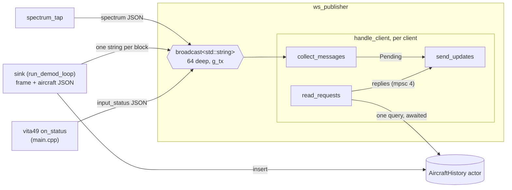
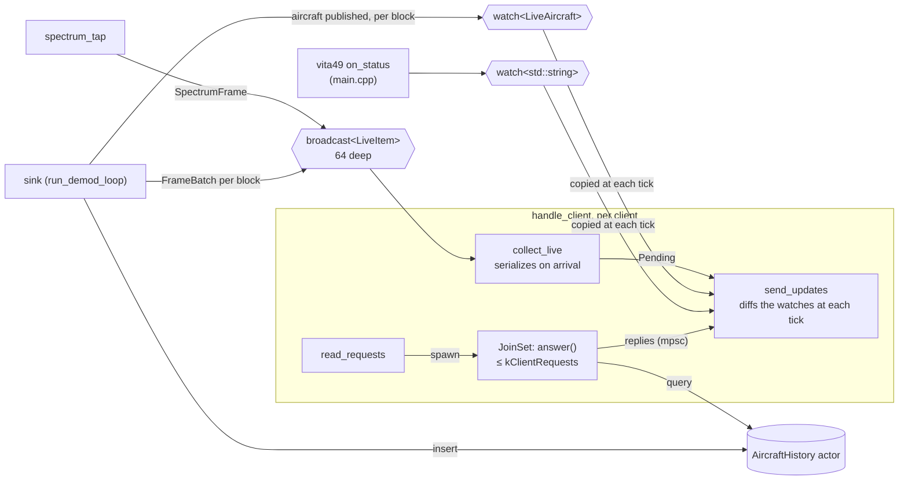
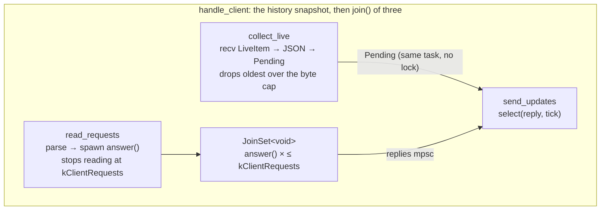

# WebSocket publisher: typed inputs and concurrent queries

Status: implemented, with the decisions from review folded in; not yet built or tested.

This changes how `adsb` feeds the WebSocket publisher (`src/output/ws_publisher.*`) and how each client's
history queries are answered. The publisher stays one service task in the pipeline, with a task per
client. Three things change:

1. **Frames come in as data, not JSON.** The pipeline sends decoded frames on a broadcast channel, and each
   client turns them into JSON. The sink no longer builds frame JSON.
2. **Aircraft state and input status are on watch channels.** At each update, a client copies the current
   value of each watch, compares it with the copy it sent last time, and sends only what differs.
3. **Each history query runs in a task of its own.** A client's reader spawns one task per request into a
   JoinSet, capped per client, and goes straight back to reading.

The globals go away too. `main.cpp` makes the channels and hands each producer its sender, so every
connection the publisher has is in the code that wires the pipeline.

The JSON the UI receives doesn't change, so the UI needs no change. What changes is which messages share an
update, and that an aircraft that changed several times in one interval is sent once.

## Today



- **Everything is a string.** `handle_frame()` builds each frame's JSON, and each published aircraft's, in
  the sink. `spectrum_tap` and `publish_input_status()` build theirs. All of them send through the global
  `g_tx`, reached through `ws_publisher_publish()` and `ws_publisher_sender()`.
- **Collection is already per client.** `collect_messages()` drains the client's broadcast receiver into
  its own `Pending` as values arrive, so a slow socket never leaves values sitting in the ring.
  `send_updates()` sends `Pending` as one JSON array each interval. This design keeps that.
- **Every aircraft update goes out.** An aircraft goes out when a decoded field changes, and at least once a
  second. If one changes five times in an interval, the client gets five copies, and the UI keeps only the
  last (`_pendingAircraft[icao] = ac`).
- **One query at a time per client.** `read_requests()` awaits each query before it reads the next message
  from the socket.

## Proposed



### Live frames and spectrum: a typed broadcast

```cpp
// output/ws_publisher.h

/** A frame as the UI shows it: validated, with the summary that needs the sink's AircraftTracker. */
struct PublishedFrame {
    DecodedFrameView view;
    std::string summary;  // frame_summary(); empty for none, sent as null
};

/** One block's frames, or a spectrum row: what every client receives, in the order it was sent. */
using LiveItem = std::variant<std::shared_ptr<const std::vector<PublishedFrame>>,
                              std::shared_ptr<const SpectrumFrame>>;
```

- **Data instead of strings.** The sink sends one `LiveItem` per block that has frames, instead of one
  string. `spectrum_tap` sends one per spectrum row on its own clone of the sender, as it does now. The tap
  isn't a task: it's the first stage of the stream the demodulate task pulls, so it needs a sender separate
  from the sink's.
- **Why a `shared_ptr` here.** A broadcast copies the value for each receiver, unlike a watch. With
  `shared_ptr<const>`, each copy is a reference count rather than a block of frames, or a spectrum row of
  1024 values.
- **The summary is computed in the sink.** `frame_summary()` reads the aircraft the frame belongs to, and
  only the sink owns the tracker, so the summary travels with the frame. This is the one piece of frame
  text the sink still makes. It made it already, so nothing new is built.
- **Each client serializes as values arrive.** `collect_live()`, today's `collect_messages()`, turns each
  `LiveItem` into JSON the moment it receives it and appends that to `Pending`. The rest stays as it is:
  `Pending` keeps holding strings, `ADSB_WS_MAX_PENDING_BYTES` still caps it, and dropping the oldest
  works as it does now. Serializing on arrival spreads the work over the interval, rather than spending
  it all at the tick. The receiver is still drained as fast as values come.
- **Same channel depth.** The broadcast stays 64 deep, and `Lagged` is still logged as it is now.
- **Frame JSON comes from one function.** Today `handle_frame()` builds a frame's JSON by adding
  `"summary"` to `nlohmann::json(view)`. That moves into one function in `ws_publisher.cpp`, so the text
  comes out the same.
- **Serialized per client, not once.** Most of the time there is one client, and even a few cost little.
  The work runs on the clients' own tasks, off the pipeline's critical path. A serialize-once stage would
  add a task and a channel, and a stage that could hold the sink back. A `ws_serialize` trace zone in
  `collect_live()` shows what it costs.

### Aircraft: a watch of each aircraft's latest state

```cpp
// output/ws_publisher.h

/** An aircraft as last published. */
struct PublishedAircraft {
    double t_unix_s;   // AircraftState::last_seen_unix_s when published
    std::string json;  // `{"type":"aircraft",...}`, the text also recorded in the history
    bool operator==(const PublishedAircraft&) const = default;
};

/** Every aircraft published in the last kLiveAircraftWindowS, by ICAO address. */
using LiveAircraft = std::unordered_map<uint32_t, PublishedAircraft>;
```

The watch already holds its value in a reference-counted allocation, behind a lock. So the value is the map
itself, and each entry holds its JSON directly, with no `shared_ptr` around either.

**The sink updates the map in place.** At the end of a block that published aircraft, the sink takes
`aircraft.borrow_mut()`. Through it, the sink:

- sets each published aircraft's entry;
- erases entries older than `kLiveAircraftWindowS` (600 s).

Nothing is copied on the sink's side. The update happens under the watch's write lock. A block that published
aircraft always changes the map, so `send_if_modified()` would gain nothing.

- **The window is 600 s, the same as the history snapshot.** Ages are measured on the stream's clock, not
  the wall clock: against the newest `t_unix_s` in the block, like the history rows. A file that plays back
  faster than real time then ages its aircraft at the speed it plays.
- **The sink keeps one list of published aircraft.** `handle_frame()` already appends each published
  aircraft to `history_rows`, but only when there is a history. That list is now also kept whenever there
  is a WebSocket. The sink fills the watch from it, copying each `json`, then moves the list into
  `AircraftHistory::insert()` as it does now.

**Each client diffs by value at each tick.** Each client keeps `LiveAircraft sent`: the map as of its last
update. At each tick, `send_updates()` does three things:

1. **Copy the current value:** `LiveAircraft now = *aircraft.borrow_and_update();`. The guard is a
   temporary, so the read lock is held only during the copy, never across a `co_await`.
2. **Send the differences:** each entry of `now` that is missing from `sent`, or that differs from it, goes
   into the update as its `json`.
3. **Keep the copy:** `sent = std::move(now)`.

There's no counter to keep and no logic to decide what to send.

- **Comparing is cheap.** Two copies of a few hundred entries a second per client, compared by value.
- **Entries that disappear aren't sent.** The UI ages aircraft out on its own, and has no message for
  removing one.
- **New clients start from an empty `sent`.** So a client's first update holds every aircraft heard in the
  last 600 s.
    - **With a history**, the snapshot is still sent first, as it is now, because it carries the tracks and
      the scrubber's range. The first update then sends the aircraft's current state a second time. That's
      a one-off, and harmless, since the live entries are as new or newer.
    - **Without a history**, a new client gets the current sky at once. Today it gets nothing until each
      aircraft is next published.
- **What the UI sees.** It gets one message per aircraft per update, instead of one per publish. Its flush
  loop kept only the last of those anyway, so the table, map and trails look the same.
- **Ticks, not `changed()`.** The same pattern works waking on the watch's `changed()`, to send on every
  change and only then. Clients here are sent updates at the interval, so they copy at the tick instead.

Why a watch fits: aircraft state is "the latest per aircraft", and a watch is a latest-value channel. A
client can't lag on it, and the most it can have waiting is one entry per aircraft.

Why the spectrum isn't on a watch: the waterfall draws every row. A row comes every 150 ms, and
`--ws-interval` defaults to 1 s, so a latest-value channel would throw away about 6 rows in 7.

### Input status: a watch of its JSON

- **The channel:** a `watch<std::string>`, empty until the first status.
- **Who sends:** the vita49 source's `on_status` sends on it, instead of calling `ws_publisher_publish()`.
  `main.cpp`'s `input_status_json()` builds the JSON.
- **What clients do:** the same as for aircraft. Each client copies the current value at each tick, and
  sends it if it isn't empty and differs from the one it last sent.
- **What changes:** the status goes out at most once per update, and only when it changed. Today every
  status is broadcast, roughly every couple of seconds.
- **Why it's still JSON:** `adsb_output` doesn't link `adsb_input`, where `InputStatus` lives. A typed
  status can come with the decode/outputs split.
- **The callback:** `on_status` is a `std::function`, so it needs a copyable callable. `WatchSender` is
  move-only, so the lambda captures a pointer to the sender. The sender is owned by `async_main` and
  outlives the source.

### History queries: one task per request

```cpp
// ws_publisher.cpp, anonymous namespace

// Most history queries one client may have waiting at once. The UI has at most one of each kind out.
constexpr size_t kClientRequests = 4;

// Runs one query and queues its reply for send_updates(). `history` is this task's own handle.
template <typename Query>
coro::Coro<void> answer(AircraftHistory history, coro::MpscSender<std::string> replies, Query query) {
    if (auto reply = co_await query(history)) co_await replies.send(std::move(*reply));
}
```

- **The reader spawns and moves on.** `read_requests()` parses each message, as it does now. A valid one
  becomes a lambda that captures the request's values and calls the matching `AircraftHistory` method,
  for example `[t](AircraftHistory& h) { return h.snapshot(t); }`. The reader spawns `answer()` with a
  fresh `history.clone()` and `replies.clone()` into a JoinSet local to `read_requests()`, then reads
  the next message straight away. Each task follows its own request, and the JoinSet holds the tasks, so
  the reader never juggles them.
- **The lambda is safe in the coroutine.** It isn't a coroutine itself. It's stored in `answer()`'s frame,
  and the coroutine it returns refers to `history`, which is in that same frame.
- **The reader drains the JoinSet as it goes.** The loop is the `select()` / `when()` pattern that `run()`'s
  accept loop already uses:

    ```cpp
    auto r = co_await coro::select(
        coro::when(in_flight < kClientRequests, [&] { return ws.receive(); }),
        coro::when(in_flight > 0, [&] { return coro::next(requests); }));
    ```

    The reader counts `in_flight` itself (incremented on spawn, decremented on each `next()`), since
    JoinSet has no `size()`. Draining as it goes stops finished tasks piling up for the life of the
    connection.
- **The cap is backpressure.** At `kClientRequests` tasks, the reader stops reading the socket until one
  finishes. A client sending a flood of requests then waits in its own socket buffer. It can't create tasks
  without limit, and it can't fill the history actor's queue on its own. This follows the "every queue is
  bounded" rule.
- **One writer.** The tasks queue their replies on the replies channel, and `send_updates()` stays the only
  task that writes to the socket. Its depth goes from 4 to `kClientRequests`, so every task in flight can
  queue its reply without waiting on the others.
- **Replies may now finish in a different order from their requests.** That's safe with today's UI:
    - seek, heatmap and activity each have at most one request out (`_seekInFlight`, `_heatmapInFlight`,
      `_activityInFlight`);
    - `_onAircraftHistory()` ignores a reply for an aircraft that is no longer selected.

    A future request kind that can have two out at once will need an id that its reply echoes back.
- **A disconnect cancels the queries still waiting.** The reader ends when `ws.receive()` throws, and its
  JoinSet's destructor cancels what's left.
- **The welcome snapshot stays where it is.** The snapshot sent to a new client stays before the `join()`, as
  it is now. The UI treats the first snapshot it receives as the backfill, so the snapshot has to arrive
  before the first update.

#### Skipping queries nobody is waiting for

A cancelled `answer()` task drops its oneshot receiver, but its request may still be sitting in the history
actor's queue.

- **Today**, when the actor reaches that request, it runs the query anyway. A heatmap can take a fraction of
  a second. Then it sends the reply into a closed oneshot, where it's thrown away. Meanwhile the inserts and
  other clients' queries behind it wait.
- **The fix** is for the actor to check `reply.is_closed()` before running a query, and skip it if nobody is
  waiting. That's one check where the actor dispatches queries, with nothing logged: the cost of a query
  now and then for a client that has gone isn't worth more.

This happens today too, when a client disconnects mid-query. With up to `kClientRequests` queued per client,
it can now happen four times per disconnect, so the check belongs in this change.

#### Effect on the history actor's queue

The actor runs queries and inserts in turn, through one queue that's `kQueueRequests` (16) deep. Its
comment assumes "at most one per WebSocket client". With this design, each client can have up to
`kClientRequests` queries waiting, so an insert from the sink can sit behind more of them. The demod queue
(64 blocks) absorbs a stall, and the actor's file comment already says writes wait behind queries. The
point of the change is still to answer more queries at once, not to delay inserts.

- **In this change:** fix the `kQueueRequests` comment.
- **Later, if a stall ever shows up:** either drain inserts first, or move queries onto their own read-only
  connections. WAL mode lets readers run while the writer writes. Both are out of scope here.

### Wiring: no globals

```cpp
// output/ws_publisher.h

/** The senders a pipeline publishes to the clients on. Each is for one task; clone for another. */
struct WsPublisherSenders {
    coro::BroadcastSender<LiveItem> live;
    coro::WatchSender<LiveAircraft> aircraft;
    coro::WatchSender<std::string> input_status;
};

/** The other ends, for ws_publisher_spawn(). */
struct WsPublisherReceivers {
    coro::BroadcastReceiver<LiveItem> live;
    coro::WatchReceiver<LiveAircraft> aircraft;
    coro::WatchReceiver<std::string> input_status;
};

/** Makes the publisher's channels: the broadcast 64 deep, each watch starting empty. */
std::pair<WsPublisherSenders, WsPublisherReceivers> ws_publisher_channels();

/** Starts the server on `port`, on all interfaces, as a detached task. Call from within the coro runtime. */
void ws_publisher_spawn(uint16_t port, std::chrono::nanoseconds update_interval, WsPublisherReceivers inputs,
                        std::optional<AircraftHistory> history);
```

- **Removed:** `g_tx`, `ws_publisher_init()`, `ws_publisher_publish()` and `ws_publisher_sender()`.
- **Normal mode.** When there's a `--ws-port`, `main.cpp` makes the channels. It passes the receivers to
  `ws_publisher_spawn()`, and moves the senders into `run_demod_loop()` as
  `std::optional<WsPublisherSenders>`. It also captures a pointer to `input_status` for the vita49
  `on_status` callback.
    - `run_demod_loop()` gives `spectrum_tap` a clone of `live`, and the sink keeps the rest.
    - `--spectrum` without `--ws-port` warns as it does now, but the test becomes "no senders" rather than
      "`ws_publisher_sender()` returned nullopt".
    - Each client gets its own `resubscribe()` of `live`, and its own `clone()` of each watch receiver.
- **Serve mode.** `main.cpp` makes the channels and drops the senders. The broadcast closes, so each client's
  `collect_live()` returns at once, as `collect_messages()` already does on a closed channel. The watches
  keep their empty initial values, so their diffs are always empty. Clients get the history snapshot and
  their query replies, as they do today.
- **Shutdown doesn't change.** When the input ends, the sink drops its senders, so the broadcast closes and
  the watches keep their last values. The publisher stays a detached service that the runtime cancels and
  drains when `async_main` returns.
- **The README's `adsb` diagram** gets the three channels in place of the one broadcast.

## The client, put together



At each tick, `send_updates()` builds one JSON array, in this order:

1. what `Pending` holds: frames and spectrum, in the order they were sent;
2. each aircraft that differs from the client's `sent` copy;
3. the input status, if it differs from the one last sent.

If all three are empty, nothing is sent, as now. A reply is still sent as soon as it arrives, without
waiting for the next tick.

## Changes by file

- `src/output/ws_publisher.h`:
    - add `PublishedFrame`, `LiveItem`, `PublishedAircraft`, `LiveAircraft`, the two channel structs,
      `ws_publisher_channels()` and `ws_publisher_spawn()`;
    - remove the publish and sender functions;
    - rewrite the file comment.
- `src/output/ws_publisher.cpp`:
    - in `collect_live()`, serialize on arrival;
    - in `send_updates()`, diff the aircraft and input-status watches at each tick;
    - in `read_requests()`, add `answer()` and the JoinSet;
    - remove `g_tx`.
- `src/output/aircraft_history.h`/`.cpp`: skip queries whose reply is closed, and fix the `kQueueRequests`
  comment.
- `src/apps/adsb/pipeline.h`/`.cpp`:
    - in `handle_frame()`, append a `PublishedFrame` to the block's batch, instead of a string;
    - keep the published-aircraft list whenever there is a WebSocket or a history;
    - the sink sends one `LiveItem` per block that has frames, and updates the aircraft watch in place;
    - `spectrum_tap` sends `SpectrumFrame`s;
    - `run_demod_loop()` takes `std::optional<WsPublisherSenders>`.
- `src/apps/adsb/main.cpp`: make the channels, wire the senders and receivers, and send `on_status` to the
  watch.
- `README.md`: update the `adsb` diagram and its numbered list.
- Tests: no test calls `handle_frame()` or the publisher today, so none change.

## Testing (yours to run)

- **Live:** with `rtlsdr` or `vita49` and the UI, check that the frames table, aircraft table, map trails,
  waterfall (`--spectrum`) and input-status banner behave as they do now.
- **Two clients at once:** both should show the same thing.
- **A client connecting mid-run without `--history`:** it should show the aircraft heard in the last
  600 s on its first update.
- **History queries:** scrub the timeline while the heatmap is on and an aircraft is selected, so that
  several queries are out at once. Close the tab mid-heatmap. The next client should be answered promptly.
- **Serve mode:** the snapshot, seek, heatmap and activity should all work, with no live data.
- **Tracy:** compare `sink_block` before and after, and look at the new `ws_serialize` zone.

## Decisions

1. **Frames are serialized per client.** There's usually one client, and the work stays off the pipeline's
   critical path.
2. **`kClientRequests` = 4.**
3. **`kLiveAircraftWindowS` = 600 s,** the same as the history snapshot.
4. **Input status stays JSON** until the decode/outputs split.
5. **The actor skips queries whose reply is closed,** in this change.
6. **No `shared_ptr` inside a watch.** Clients diff copies of the watch's value, and track no per-entry
   sequence numbers.
